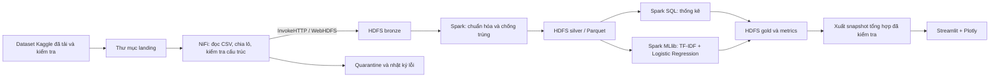

# KẾ HOẠCH ĐỒ ÁN: PHÂN TÍCH DỮ LIỆU ĐÁNH GIÁ TRÒ CHƠI TRÊN STEAM

**Thời gian:** 15 ngày liên tục, ký hiệu D1–D15.  
**Nhân sự:** 3 thành viên, ký hiệu TV1, TV2, TV3; thay bằng họ tên/MSSV khi đăng ký.  
**Công nghệ chính:** Apache NiFi, HDFS, Apache Spark/PySpark, Spark MLlib, Streamlit và Plotly.  
**Dataset:** [Steam Reviews Dataset 2021 — najzeko](https://www.kaggle.com/datasets/najzeko/steam-reviews-2021/data).  
**Ngày lập kế hoạch:** 01/10/2026. Nếu bắt đầu ngay, D1–D15 tương ứng 01–15/10/2026; đây là lịch nội bộ, không phải hạn nộp do giảng viên công bố.  
**Trạng thái:** Kế hoạch đề xuất; chưa cài đặt hệ thống, tải toàn bộ dataset hoặc có kết quả thực nghiệm.

## 1. Căn cứ quy định và những việc cần xác nhận

Đã đọc toàn bộ hai tài liệu trong thư mục `Rule`:

- **R1:** [Quy định đồ án Dữ liệu lớn và danh sách gợi ý đề tài](<Rule/QD Do an Du lieu lon va Danh sach goi y 1 so de tai.pdf>), 3 trang.
- **R2:** [Kế hoạch đồ án môn học Nhập môn Big Data](<Rule/Ke hoach Do an mon hoc Nhap mon Big data.pdf>), 5 trang.

| Nội dung từ quy định | Cách áp dụng vào đồ án |
|---|---|
| R1 tr.1 yêu cầu lưu trữ và xử lý phân tán; R2 tr.1 yêu cầu ít nhất một công nghệ Big Data/lưu trữ, xử lý phân tán | Dùng HDFS lưu dữ liệu, Spark xử lý và huấn luyện; NiFi đảm nhiệm tiếp nhận, chuyển đổi và điều phối luồng dữ liệu. |
| R2 tr.1 ghi **nhóm 2 sinh viên** | Kế hoạch này lập cho **3 người theo yêu cầu của nhóm**. D1, TV1 đề nghị giảng viên chấp thuận số lượng; chưa xem phương án 3 người là đã được duyệt. |
| R2 tr.1–2 yêu cầu đề tài tự đề xuất được giảng viên xem xét, chấp thuận | D1 chuẩn bị đề cương một trang: đề tài, dataset, kiến trúc, đầu ra, phân công; xác nhận cả phạm vi dữ liệu và cách triển khai cụm. |
| R2 tr.4 quy định đồ án chiếm 50% điểm học phần, hai giai đoạn lần lượt 30% và 70% điểm đồ án | Chuẩn bị gói tiến độ ở D7 và gói hoàn chỉnh ở D15. Hai mốc này là mốc nội bộ. |
| R2 tr.4 có chỗ ghi giai đoạn 1 ở tuần 6–7, có chỗ ghi tuần 5–6; kế hoạch tổng thể 10 tuần | TV1 xác nhận hạn nộp/thuyết trình thực tế với giảng viên trong D1; điều chỉnh ngày nộp mà vẫn giữ đủ hai giai đoạn. |
| R1 tr.2 và R2 tr.2 yêu cầu nộp Classroom: mã nguồn, báo cáo Word, PPT; có demo | Bàn giao đủ source/config, `.docx`, `.pptx`, hướng dẫn chạy, dữ liệu hoặc liên kết dữ liệu; video demo là phương án dự phòng. |
| R2 tr.2 yêu cầu lịch làm việc và đóng góp từng người; tr.5 quy định xử lý sao chép | Ghi nhật ký hằng ngày, tổng hợp tuần D1–D7/D8–D14 và ngày D15; dẫn nguồn, lưu commit và kết quả tự thực nghiệm. |

**Giả định lập lịch:** mỗi người dành trung bình 4 giờ/ngày, khoảng 60 giờ/người, tổng 180 giờ. Mỗi ngày gồm khoảng 3 giờ công việc chính và 1 giờ kiểm tra, tài liệu, trao đổi. Nếu nhân sự chỉ có 1–2 giờ/ngày, phải giảm phạm vi hoặc kéo dài lịch. Việc xác nhận quy định là đầu việc của nhóm; không cản trở việc chuẩn bị kế hoạch này.

## 2. Mục tiêu, câu hỏi phân tích và phạm vi

Xây dựng một quy trình có thể chạy lại, từ dữ liệu Steam gốc đến dashboard và mô hình dự đoán người viết có khuyến nghị trò chơi hay không. Kết quả hỗ trợ nhận diện trò chơi/nhóm đánh giá cần xem xét sâu hơn và mô tả mối liên hệ giữa nội dung, thời gian chơi, ngôn ngữ và mức khuyến nghị.

### 2.1. Các câu hỏi phải trả lời

1. Trò chơi nào có nhiều đánh giá, tỷ lệ khuyến nghị cao/thấp? Luôn hiển thị số lượng đánh giá đi kèm tỷ lệ.
2. Số đánh giá và tỷ lệ khuyến nghị thay đổi thế nào theo tháng trong khoảng thời gian thực có của dataset?
3. Phân bố ngôn ngữ và sự khác biệt về tỷ lệ khuyến nghị giữa các nhóm là gì?
4. Thời gian chơi tại thời điểm đánh giá liên hệ thế nào với khuyến nghị? Đây là phân tích liên hệ, không kết luận nhân quả.
5. Mô hình dùng nội dung đánh giá tiếng Anh dự đoán nhãn khuyến nghị tốt hơn baseline đa số ở mức nào?

### 2.2. Phạm vi bắt buộc trong 15 ngày

- Pipeline NiFi có phân lô, nhánh lỗi, retry có giới hạn, back pressure và bằng chứng provenance.
- HDFS lưu dữ liệu; Spark chạy qua master/worker, có bằng chứng executor thực sự xử lý dữ liệu.
- Làm sạch, chống trùng, thống kê chất lượng; dữ liệu sạch và bảng tổng hợp lưu Parquet.
- Phân tích mô tả tất cả ngôn ngữ trong phạm vi dữ liệu đã chọn; ML chỉ dùng đánh giá tiếng Anh có văn bản và nhãn hợp lệ.
- Baseline dự đoán lớp đa số và một mô hình TF-IDF + Logistic Regression bằng Spark MLlib.
- Dashboard 4 trang, tối thiểu 6 biểu đồ có ý nghĩa; báo cáo ít nhất 5 nhận xét gắn với số liệu thực.
- Báo cáo Word, slide, demo, hướng dẫn chạy và bảng đóng góp.

**Chỉ mở rộng sau khi lõi hoàn tất:** thêm Naive Bayes để so sánh hoặc phân tích từ khóa. Không đưa streaming thời gian thực, crawl Steam trực tiếp, BERT, dịch đa ngôn ngữ hay hệ gợi ý vào phạm vi bắt buộc. Dataset là snapshot; không mặc định mọi đánh giá đều thuộc năm 2021. Nhãn khuyến nghị không phải bộ nhãn cảm xúc ba lớp; không tự tạo lớp “trung lập”.

## 3. Dữ liệu và chiến lược quy mô

### 3.1. Những gì đã xác minh và cần đo lại

Metadata công khai của [Kaggle API — dataset detail](https://www.kaggle.com/api/v1/datasets/view/najzeko/steam-reviews-2021), truy cập 01/10/2026, mô tả **khoảng 21 triệu đánh giá, khoảng 300 trò chơi**, thu thập qua Steam API, phiên bản 1. Đây là mô tả của bên cung cấp, chưa phải số đếm thực nghiệm của nhóm.

API chi tiết trả `totalBytes = 8.171.787.229`, còn [API danh sách](https://www.kaggle.com/api/v1/datasets/list?search=steam-reviews-2021) trả `3.193.406.910`. Hai giá trị chưa thống nhất; không suy diễn chắc chắn đâu là kích thước nén/giải nén. D2 phải ghi kích thước tệp thực, tên tệp, checksum SHA-256, số cột, số bản ghi, khoảng thời gian và phân bố ngôn ngữ sau khi tải. Metadata ghi giấy phép `GPL 2`; lưu thông tin nguồn/giấy phép cùng phiên bản dữ liệu.

### 3.2. Ba mức chạy

| Mức | Mục đích và phạm vi dự kiến | Cách nghiệm thu |
|---|---|---|
| Smoke | Khoảng 10.000 bản ghi và fixture lỗi nhỏ | CSV có dấu phẩy, dấu nháy, xuống dòng, Unicode vẫn đọc đúng; chạy được toàn luồng. |
| Core | Mục tiêu 1 triệu bản ghi hợp lệ cho ETL/EDA; ML lấy tối đa khoảng 200.000 đánh giá tiếng Anh | Ghi số lượng thực tế, seed, điều kiện lấy mẫu, phân bố game/ngôn ngữ/nhãn; không lấy máy móc 1 triệu dòng đầu. |
| Full | Thử xử lý toàn bộ dataset cho ETL và bảng tổng hợp ở D10–D11 nếu tài nguyên cho phép | Công bố rõ chạy full hay subset; ghi thời gian, dung lượng, số bản ghi và lý do giới hạn. ML không bắt buộc huấn luyện trên toàn bộ. |

Mức Core là **mục tiêu kỹ thuật của nhóm**, không phải ngưỡng tối thiểu do `Rule` quy định. Chốt mức dữ liệu với giảng viên. D2 thử đọc tuần tự và tạo mẫu xác định theo hash của ID; kiểm tra độ đại diện theo game/ngôn ngữ/nhãn trước khi dùng. Nếu phải lấy mẫu phân tầng, ghi quota và giới hạn suy rộng; không dùng tỷ lệ của mẫu đã cân bằng nhãn để đại diện toàn dataset.

### 3.3. Hợp đồng dữ liệu phiên bản 1 — chốt cuối D2

Các tên cột nguồn dưới đây là **dự kiến cần đối chiếu header thực**, không phải schema đã được xác minh từ tệp. Nếu khác tên, TV2 cập nhật bảng ánh xạ; không âm thầm bỏ cột bắt buộc.

| Cột nguồn dự kiến | Tên chuẩn/kiểu | Quy tắc |
|---|---|---|
| `review_id` | `review_id: string` | Khóa đánh giá; không dùng số dòng CSV làm ID. |
| `app_id`, `app_name` | `app_id: string`, `app_name: string` | ID bắt buộc cho phân tích theo game; tên thiếu có thể hiển thị ID. |
| `language` | `language: string` | Chuẩn hóa khoảng trắng/chữ thường; giữ nhóm `unknown` khi thiếu. |
| `review` | `review_text: string` | Giữ bản gốc; tạo bản văn bản chuẩn hóa riêng cho ML. |
| `recommended` | `recommended: boolean` | Chỉ chấp nhận ánh xạ đã công bố; không đổi thiếu/không hợp lệ thành `false`. |
| `timestamp_created`, `timestamp_updated` | `created_at`, `updated_at: timestamp` | Xác minh đơn vị thời gian; chuẩn hóa UTC; không ép ngày thiếu thành ngày hiện tại. |
| `author.playtime_at_review` | `playtime_at_review_minutes: double` | Dùng nếu thực sự tồn tại; kiểm tra đơn vị, số âm và null. |
| `author.playtime_forever` | `playtime_forever_minutes: double` | Mô tả tại lúc thu thập; không thay thế ngầm cho playtime tại thời điểm đánh giá. |
| `votes_helpful`, `votes_funny` | Các cột số đếm kiểu long | Dùng mô tả nếu có; không đưa vào mô hình văn bản bắt buộc. |
| Thuộc tính luồng dữ liệu | `dataset_version`, `batch_id`, `source_file`, `ingested_at` | Bổ sung để truy vết và chạy lại. |

Xử lý dữ liệu:

- Bản ghi thiếu ID/game/nhãn hoặc lỗi cấu trúc đi vào quarantine với mã lý do. Tệp CSV không parse được đi nhánh lỗi cấp tệp; không báo giả số bản ghi lỗi khi chưa đọc được.
- Đánh giá không có văn bản vẫn có thể dùng cho thống kê nhãn; loại khỏi tập ML và đếm riêng. Ngày thiếu chỉ loại khỏi biểu đồ thời gian, không loại toàn bộ bản ghi hợp lệ.
- Deduplicate toàn bộ phạm vi bằng `review_id`; nếu có nhiều phiên bản, giữ `updated_at` mới nhất, có quy tắc phụ xác định khi bằng nhau/thiếu ngày. Lưu số trùng bị loại.
- Cột có dấu chấm phải được tham chiếu/đổi tên đúng; không tự diễn giải chúng là cấu trúc lồng nhau.
- Không xóa tất cả outlier thời gian chơi: giữ bản gốc, đánh dấu; biểu đồ có thể giới hạn trục và phải ghi chú.
- Nếu thiếu `playtime_at_review`, chuyển câu hỏi số 4 sang thời gian chơi tại lúc thu thập và ghi rõ giới hạn. Nếu thiếu nhãn hoặc nội dung văn bản, đánh dấu chặn phần ML và đối chiếu lại tệp nguồn ngay D2.

## 4. Kiến trúc và cách triển khai



**Lựa chọn thiết kế:** NiFi tiếp nhận và theo dõi dữ liệu; HDFS phụ trách lưu trữ phân tán; Spark xử lý xuyên nhiều lô và huấn luyện. Không tính thống kê toàn tập bằng cách lấy trung bình các tỷ lệ từng FlowFile. Dashboard chỉ đọc bảng tổng hợp/snapshot nhỏ đã xuất, không nạp hàng triệu review vào RAM.

### 4.1. Môi trường

- Ưu tiên Docker Compose trên Linux/WSL2: 1 NiFi, 1 HDFS NameNode + 2 DataNode, 1 Spark master + 2 worker, 1 ứng dụng dashboard. Mỗi dịch vụ có volume và cấu hình được lưu trong repo.
- Cụm container trên một máy là mô phỏng nhiều nút; trình bày đúng giới hạn tài nguyên và miền lỗi. Nếu giảng viên yêu cầu nhiều máy vật lý, TV1 chốt phân bố qua các máy trong D1–D2.
- Cấu hình dự trù: máy chạy cụm khoảng 24–32 GB RAM, SSD còn khoảng 80–100 GB; đây là ngân sách ước tính, phải đo ở D2. Nếu chỉ có 16 GB, giảm mẫu và chạy ETL/ML/dashboard theo lượt; ưu tiên chuyển cụm sang máy phòng lab khi cần.
- Dự trù dung lượng theo: tệp tải + giải nén + NiFi content repository + dữ liệu HDFS có replication + Parquet + shuffle/checkpoint + phần trống vận hành. Không lấy dung lượng dataset làm toàn bộ dung lượng cần thiết.
- D1 chọn và D2 khóa phiên bản/image digest, Python và Java theo kiểm tra tương thích. Dùng NiFi dòng 2.x; tài liệu Apache hiện yêu cầu Java 21 cho NiFi. Java/Python của Spark và Hadoop được kiểm tra riêng theo bản đã chọn, không buộc dùng chung một runtime. [Apache NiFi README](https://github.com/apache/nifi/blob/main/README.md)
- Hai DataNode dùng replication dự kiến 2; xác minh bằng `hdfs dfsadmin -report` và `hdfs fsck`. Hai Spark worker phải có executor/task thực tế, kiểm tra qua Spark UI/event log.

### 4.2. Luồng NiFi cần bàn giao

Thiết kế dùng các processor/service hiện có tài liệu chính thức: [CSVReader](https://nifi.apache.org/components/org.apache.nifi.csv.CSVReader/), [SplitRecord](https://nifi.apache.org/components/org.apache.nifi.processors.standard.SplitRecord/), [InvokeHTTP](https://nifi.apache.org/components/org.apache.nifi.processors.standard.InvokeHTTP/). Kiểm tra tên thuộc tính theo phiên bản đã khóa trong D2.

1. **Landing:** tải/giải nén dataset bằng công cụ Kaggle hoặc trình duyệt, lưu checksum. NiFi dùng `ListFile → FetchFile` đọc bản sao bất biến; chỉ công bố tệp hoàn tất vào landing bằng đổi tên để tránh đọc khi đang tải dở.
2. **Chia lô:** `SplitRecord` với `CSVReader` và writer theo record; khởi đầu khoảng 50.000 record/lô, điều chỉnh ở D4. Chốt encoding, header, quote, escape và schema nullable từ mẫu thực. Không dùng cắt theo dòng vì review có thể xuống dòng.
3. **Kiểm tra:** tách lỗi parse cấp tệp, lỗi cấu trúc cấp record khi có thể nhận diện. Giữ dữ liệu gốc tại landing; bronze lưu lô chuẩn hóa định dạng, còn luật làm sạch nghiệp vụ do Spark xử lý.
4. **Ghi HDFS:** dùng `InvokeHTTP` gọi WebHDFS; bước đầu PUT không gửi nội dung, nhận vị trí DataNode, bước sau PUT nội dung tới vị trí đó và kiểm tra trạng thái tạo thành công. Giữ nội dung FlowFile gốc trong quá trình nhận phản hồi. Kiểm tra riêng redirect, hostname DataNode và cổng trong mạng container. Không giả định `PutHDFS` có sẵn ở mọi bản NiFi. [Quy trình CREATE của WebHDFS](https://hadoop.apache.org/docs/stable/hadoop-project-dist/hadoop-hdfs/WebHDFS.html#Create_and_Write_to_a_File)
5. **Chạy lại:** `batch_id` dựa trên checksum nguồn + chỉ số lô + phiên bản schema; ghi vào đường dẫn tạm, kiểm tra rồi commit/rename. Manifest chứa số lô dự kiến/đã hoàn tất, số record, checksum, trạng thái. Chỉ phát hành dấu hoàn tất sau khi toàn bộ lô của đợt đã commit; Spark chỉ đọc đợt hoàn tất.
6. **Lỗi và tải:** thử tối đa 3 lần với lỗi kết nối/tạm thời, sau đó chuyển hàng đợi lỗi để xử lý thủ công. Lỗi schema không retry vô hạn. Khởi đầu back pressure khoảng 100 FlowFile hoặc 256 MB ở các queue giữa lô, rồi điều chỉnh theo số đo; ngưỡng không phải giới hạn cứng kích thước một tệp.
7. **Bằng chứng:** export flow dạng JSON, ảnh processor/provenance, số lô vào–ra–lỗi, log thử gián đoạn HDFS và chạy lại. Replay không được làm tăng số review duy nhất ở silver.

Chỉ chạy một phiên ghi cho cùng `batch_id`. Khi retry gặp tệp đích đã có, xác minh manifest/checksum trước khi coi là thành công; không ghi đè mù. Chống trùng ở Spark vẫn cần thiết, không tuyên bố toàn hệ thống có bảo đảm exactly-once.

### 4.3. Tổ chức dữ liệu và mã nguồn theo Clean Architecture

Bộ khung thư mục đã được tạo; pipeline, mô hình và dashboard chưa triển khai. Xem `README.md`, `docs/architecture.md` để biết trách nhiệm/chiều phụ thuộc và `Checklist.md` để theo dõi công việc của 3 thành viên.

```text
Bigdata/
├── Plan.md
├── Checklist.md                  # Checklist theo thành viên và ngày
├── Rule/                         # Quy định đầu vào
├── infra/                        # Compose, cấu hình, .env.example, phiên bản
├── nifi/                         # Flow JSON, parameters.example, hướng dẫn import
├── schemas/                      # Schema nguồn, chuẩn hóa, gold
├── src/steam_reviews/
│   ├── domain/                   # Entities và policies thuần Python
│   ├── application/              # Ports, DTO và use cases
│   ├── infrastructure/           # Adapter ingestion/storage/Spark/MLlib
│   ├── presentation/             # CLI và dashboard
│   └── bootstrap/                # Cấu hình và ghép dependency
├── scripts/                      # Wrapper vận hành/submit, không chứa nghiệp vụ
├── tests/                        # Unit, integration, e2e và fixtures
├── data/                         # Landing/sample/cache, không commit dữ liệu lớn
├── artifacts/                    # Metrics, mô hình tham chiếu, manifest, biểu đồ
├── docs/                         # Từ điển dữ liệu, kiến trúc, nhật ký, hướng dẫn
├── report/                       # word/, slides/, demo/
└── README.md

HDFS: /steam/bronze/<dataset_version>/<batch_id>/
      /steam/silver/<run_id>/
      /steam/gold/<run_id>/
      /steam/quarantine/<run_id>/
```

Chọn phân vùng silver theo năm/tháng khi phù hợp dữ liệu thực; tránh chia nhỏ theo hàng trăm game × nhiều ngôn ngữ. Gom tệp Parquet theo dung lượng mục tiêu đo được. Mỗi snapshot có `run_id`, schema version, phạm vi mẫu và thời điểm tạo; dashboard không trộn nhiều lần chạy.

## 5. Phân tích, mô hình và dashboard

### 5.1. Bảng kết quả và công thức

| Bảng/đầu ra | Nội dung tối thiểu | Kiểm tra |
|---|---|---|
| `quality_summary` | Nguồn, số đọc được, lỗi, trùng, thiếu văn bản/thời gian, số sạch | Đối soát tổng; số lỗi theo lý do không bị đếm chồng trong phương trình tổng. |
| `game_summary` | Game, tổng review hợp lệ, số khuyến nghị, tỷ lệ khuyến nghị | `rate = recommended_count / valid_label_count`; mẫu số 0 hiển thị N/A. |
| `monthly_summary` | Game, tháng UTC, ngôn ngữ, tổng và số khuyến nghị | Tổng theo tháng khớp phần dữ liệu có ngày hợp lệ. |
| `language_summary` | Ngôn ngữ, số review, tỷ lệ khuyến nghị | Hiển thị `unknown`; không suy ngôn ngữ thành quốc gia. |
| `playtime_summary` | Nhóm giờ chơi, số review, tỷ lệ; số thiếu/âm riêng | Đổi phút sang giờ đúng; khoảng không chồng nhau: [0,2), [2,10), [10,50), [50,100), [100,+∞). |
| `model_metrics` | Baseline, LR, số mẫu mỗi split/lớp, F1, precision, recall, PR-AUC, confusion matrix | Đọc được cả nhãn và định nghĩa lớp dương; tính macro-F1 rõ ràng. |

Xếp hạng tỷ lệ theo game dùng ngưỡng mặc định ít nhất 100 đánh giá trong phạm vi lọc; người dùng có thể đổi ngưỡng. Khi kết hợp nhóm, cộng tử số/mẫu số rồi mới chia. Nếu có bộ lọc phối hợp game–ngôn ngữ–tháng, bảng gold phải giữ đủ các chiều đó; không áp bộ lọc lên bảng đã mất chiều.

### 5.2. Thiết kế ML khả thi

- **Bài toán:** phân loại nhị phân `recommended` từ `review_text`; nhãn 1 = khuyến nghị, 0 = không khuyến nghị. Giải thích đây là học nhãn hành vi khuyến nghị, không phải đánh giá cảm xúc tuyệt đối.
- **Tập dữ liệu:** tiếng Anh, text không rỗng, nhãn hợp lệ; loại trùng ID trước khi chia. Chuẩn hóa text nhẹ, giữ từ phủ định; kiểm tra các nội dung giống nhau giữa các split.
- **Chia tập:** mặc định 70/15/15 train/validation/test bằng hash có seed cố định của nhóm văn bản chuẩn hóa, để văn bản trùng không rơi sang nhiều tập. Báo cáo tỷ lệ thực tế và phân bố nhãn/game. Không khẳng định đây là phép thử dự báo tương lai; có thể thêm holdout thời gian nếu còn thời gian.
- **Baseline:** luôn dự đoán lớp phổ biến nhất xác định trên train; chấm trên cùng validation/test với mô hình.
- **Pipeline:** RegexTokenizer → bước loại stopword có giữ phủ định → HashingTF → IDF → LogisticRegression. Fit IDF và mô hình chỉ trên train. Spark có triển khai Logistic Regression trong `spark.ml`. [Tài liệu Spark](https://spark.apache.org/docs/latest/ml-classification-regression.html#logistic-regression)
- **Thử nghiệm giới hạn:** bắt đầu `numFeatures=2^16`, `maxIter=30`; thử `regParam` 0,01 và 0,1; so sánh có/không trọng số lớp tính từ train, tối đa 4 cấu hình. Chọn bằng macro-F1 trên validation; không dò tham số bằng test.
- **Ngăn rò rỉ:** không đưa `recommended`, ID, lượt hữu ích hay dữ liệu phát sinh sau đánh giá vào feature. Chỉ dùng nội dung text cho mô hình bắt buộc. Kiểm tra giao nhau của ID/text hash giữa train/validation/test bằng 0.
- **Đánh giá:** macro-F1 = trung bình F1 của hai lớp, cùng precision/recall từng lớp, confusion matrix và PR-AUC với lớp dương đã công bố. Không gọi weighted-F1 mặc định là macro-F1. Test được giữ lại đến khi chốt mô hình.
- **Mục tiêu nội bộ:** macro-F1 cải thiện khoảng 0,10 so với baseline trên validation, sau đó xác nhận bằng test. Đây là mục tiêu, không phải kết quả cam kết. Nếu không đạt, kiểm tra dữ liệu/nhãn, báo cáo nguyên nhân và kết quả thật; không đổi test để tăng điểm.
- **Phân tích lỗi:** xem khoảng 30 dự đoán sai, phân nhóm phủ định, mỉa mai, văn bản ngắn, nhãn khó giải thích; không hiển thị Steam ID cá nhân trên dashboard.

### 5.3. Dashboard 4 trang

1. **Tổng quan:** số review, số game, phạm vi ngày, tỷ lệ khuyến nghị; biểu đồ số đánh giá theo game và phân bố ngôn ngữ.
2. **Khám phá trò chơi:** top game theo tỷ lệ có ngưỡng số lượng; xu hướng theo tháng; bộ lọc game, ngôn ngữ, thời gian trong phạm vi gold hỗ trợ.
3. **Thời gian chơi và chất lượng dữ liệu:** số đánh giá/tỷ lệ theo nhóm giờ chơi, tỷ lệ thiếu/trùng/lỗi; chú thích rõ cột thời gian chơi dùng để tính.
4. **Mô hình:** baseline so với LR, confusion matrix, precision/recall/F1 từng lớp, phạm vi train/test, ví dụ dự đoán đã tính sẵn. Nhập text dự đoán trực tiếp là mở rộng, không là điều kiện hoàn thành.

Mỗi trang hiển thị nguồn, full/subset, cỡ mẫu và `run_id`. Biểu đồ có tiêu đề, đơn vị, mẫu số, trạng thái rỗng; các kết luận chỉ áp dụng cho tập quan sát. Không suy ra doanh thu, số người mua hoặc toàn bộ cộng đồng Steam từ số review.

## 6. Phân công 3 thành viên và quy tắc phối hợp

| Thành viên | Trách nhiệm chính | Sản phẩm chịu trách nhiệm | Người kiểm tra chéo |
|---|---|---|---|
| **TV1 — Hạ tầng và luồng dữ liệu** | Điều phối; NiFi; HDFS; môi trường cụm; ingestion, retry, benchmark I/O | `infra/`, `nifi/`, manifest, hướng dẫn dựng hệ thống; phần kiến trúc trong Word | TV2 kiểm tra dữ liệu nhận; TV3 thử dựng theo README. |
| **TV2 — Xử lý và ML** | Từ điển dữ liệu; Spark ETL/EDA; baseline, huấn luyện, đánh giá | `schemas/`, các lớp domain/application, adapter Spark/ML và CLI trong `src/steam_reviews/`; silver/gold, metrics, phần thực nghiệm trong Word | TV1 kiểm tra chạy phân tán; TV3 đối chiếu số liệu. |
| **TV3 — Dashboard và hồ sơ** | Thiết kế/chạy dashboard; kiểm tra gold; chủ trì tổng hợp Word/PPT, demo | `src/steam_reviews/presentation/dashboard/`, biểu đồ, báo cáo, slide, checklist, nhật ký đóng góp | TV2 kiểm tra nội dung; TV1 kiểm tra demo và đóng gói. |

TV3 biên tập báo cáo, nhưng TV1 và TV2 phải tự viết phần mình làm. Mỗi người khoảng 60 giờ; nếu TV2 quá tải ở D6–D9, TV1 nhận tối ưu phân vùng/đo hiệu năng, TV3 nhận SQL đối soát và đồ thị đánh giá, không để TV2 làm toàn bộ xử lý lẫn trình bày.

- Mỗi ngày họp 15 phút: việc xong, bằng chứng, việc tiếp theo, vướng mắc.
- Cuối ngày cập nhật nhật ký: công việc, thời lượng, commit/tệp, kết quả kiểm tra, người review. Tỷ lệ đóng góp cuối cùng dựa trên công việc thực, không mặc định 33,3%.
- Chốt schema và định dạng gold cuối D2; thay đổi sau đó phải báo cho cả nhóm và cập nhật version.
- Mỗi đầu việc có người chính và một người review; mỗi ngày bàn giao phần chạy được. Nhánh công việc/PR nhỏ nếu dùng Git; không commit dataset lớn, token hoặc mật khẩu.
- Vướng mắc quá 2 giờ phải báo nhóm. Khi trễ, bỏ mở rộng trước, giảm mẫu có ghi nhận sau; giữ HDFS/Spark, NiFi, mô hình cơ bản và hồ sơ bắt buộc.

## 7. Chín gói công việc và phụ thuộc

| Gói | Thời gian | Chủ trì | Đầu ra và điều kiện hoàn thành | Phụ thuộc |
|---|---|---|---|---|
| W1. Chốt đề tài/quy định | D1 | TV1 | Đề cương, phân công, danh sách xác nhận với GV; phạm vi bắt buộc rõ | Không |
| W2. Dựng môi trường/chốt dữ liệu | D1–D2 | TV1 + TV2 | Đọc được mẫu, schema v1, HDFS/Spark smoke, khóa phiên bản | W1 định hướng |
| W3. Luồng NiFi vào HDFS | D3–D4 | TV1 | Lô vào HDFS, manifest, lỗi và chạy lại có kiểm tra | W2 |
| W4. Spark làm sạch/tổng hợp | D3–D6 | TV2 | Silver/gold v1, đối soát chất lượng và KPI | W2; nghiệm thu cần W3 |
| W5. Baseline và mô hình | D6–D9 | TV2 | Split cố định, baseline/LR, metrics, mô hình lưu được | Silver của W4 |
| W6. Dashboard | D3–D10 | TV3 | 4 trang; ít nhất 6 biểu đồ, bộ lọc đúng trên gold thật | Schema W2; hoàn tất cần W4–W5 |
| W7. Tích hợp và thực nghiệm quy mô | D8–D11 | TV1 | Toàn luồng Core; thử Full nếu đủ máy; đo tài nguyên, thời gian | W3–W6 |
| W8. Hồ sơ và chuẩn bị demo | D1–D12 | TV3 | Gói tiến độ D7; Word/PPT/README/đóng góp gần hoàn chỉnh D12 | Tích lũy từ W1–W7 |
| W9. Kiểm chứng và bàn giao | D13–D15 | Cả nhóm | Chạy sạch, review chéo, diễn tập, gói nộp đủ và kiểm tra cuối | W7–W8 |

**Đường găng:** schema thực → NiFi ghi HDFS → Spark silver → gold + ML → dashboard dữ liệu thật → chạy lại → hồ sơ/demo → nộp. TV3 dựng giao diện bằng fixture từ D3 để không phải chờ ML; fixture phải ghi rõ dữ liệu minh họa và được thay bằng kết quả thật trước nghiệm thu.

## 8. Lịch chi tiết 15 ngày

Mỗi ô là phần việc chính trong khoảng 3 giờ tập trung; thời gian còn lại dành cho review/tài liệu/họp. Cuối ngày phải có bằng chứng trong repo hoặc thư mục artifacts.

| Ngày | TV1 — Hạ tầng/NiFi | TV2 — Spark/ML | TV3 — Dashboard/báo cáo | Bàn giao và tiêu chí cuối ngày |
|---|---|---|---|---|
| **D1** | Tổng hợp quy định; chuẩn bị xác nhận nhóm 3 người, đề tài và mốc nộp; kiểm kê máy; tạo khung cấu hình | Kiểm tra truy cập Kaggle; lên câu hỏi phân tích, danh sách cột cần; phác thảo pipeline | Lập bố cục Word đúng quy định, wireframe 4 trang, nhật ký nhóm | Đề cương 1 trang, vai trò, lịch, stack đề xuất; ghi rõ mục đang chờ GV. |
| **D2** | Dựng NiFi/HDFS/Spark; thử ghi–đọc HDFS và job Spark nhỏ; khóa phiên bản | Tải/đo dữ liệu; kiểm tra header, ngày/nhãn/ngôn ngữ; tạo mẫu tái lập; chốt schema | Chốt hợp đồng gold và KPI; kiểm tra mẫu, tạo fixture cho giao diện; ghi nguồn | Schema v1, manifest nguồn, môi trường smoke; quyết định mức Core và tài nguyên Full. |
| **D3** | Làm `ListFile → FetchFile → SplitRecord`; kiểm tra CSV nhiều dòng; dựng ghi WebHDFS | Viết job đọc/chuẩn hóa kiểu, null, ngày; đọc mẫu bronze; tạo ca dữ liệu lỗi | Dựng Streamlit navigation và trang tổng quan bằng fixture | 10.000 record đi từ NiFi vào HDFS; Spark đọc được; CSV multiline/Unicode không vỡ. |
| **D4** | Hoàn thiện manifest, nhánh lỗi, retry/back pressure; thử chạy lại một lô | Hoàn thiện dedup, quarantine, Parquet silver; thống kê trước/sau | Dựng trang trò chơi và bộ lọc; viết mô tả dữ liệu | Raw đọc được = hợp lệ trước dedup + lỗi record; silver = hợp lệ trước dedup − trùng. |
| **D5** | Nạp mức Core đã chốt; xác minh hai DataNode và executor; lưu ảnh/log | Tạo gold game/tháng/ngôn ngữ/playtime; SQL kiểm tra độc lập | Kết nối gold thật; kiểm tra KPI và biểu đồ; ghi nhận xét sơ bộ | **M1:** toàn luồng ingestion → silver → gold → dashboard tối thiểu chạy được. |
| **D6** | Đo tốc độ ingestion/ETL, hỗ trợ phân vùng và tài nguyên; viết phần NiFi/HDFS | Tạo split ML, baseline đa số và pipeline LR đầu tiên; lưu thông số | Làm trang chất lượng dữ liệu; tổng hợp slide tiến độ và các biểu đồ thật | Có metrics baseline và lần LR đầu tiên hoặc log lỗi cụ thể; draft tiến độ có demo ETL. |
| **D7** | Demo NiFi/HDFS, tổng hợp tồn đọng và khả năng chạy Full | Trình bày baseline, split, hướng cải thiện; kiểm tra rò rỉ | Hoàn thiện gói tiến độ, lịch làm việc tuần 1, đóng góp; trình bày thử | **M2 — Giai đoạn 1 nội bộ:** đề cương, lý thuyết, kiến trúc, kết quả sơ bộ, slide và demo; nộp theo lịch GV. |
| **D8** | Tích hợp điều kiện đợt hoàn tất và chạy tuần tự các job; thử restart dịch vụ | Chạy tối đa 4 cấu hình trên train/validation; chọn cấu hình | Hoàn thiện trang mô hình bằng metrics thật; kiểm thử trạng thái rỗng | Có mô hình chọn theo validation; pipeline không đọc lô chưa hoàn tất. |
| **D9** | Review cấu hình, log executor và hướng dẫn vận hành; sửa lỗi tích hợp | Chấm test sau khi chốt mô hình; phân tích 30 lỗi; lưu model/metrics | Đối chiếu số liệu model/dashboard; viết phần đánh giá và hạn chế | **M3:** baseline và LR so sánh trên cùng test; không trùng ID/text hash qua split. |
| **D10** | Chạy thử Full nếu đủ tài nguyên; nếu thiếu, ghi giới hạn và hoàn thiện Core; đo RAM/disk/time | Tối ưu ETL theo số đo; kiểm tra tổng giữa các mức dữ liệu | Hoàn thiện 4 trang, bộ lọc, nhãn mẫu số; ghi ít nhất 5 nhận xét | Bản chức năng hoàn chỉnh; đóng băng tính năng; xác định rõ phạm vi số liệu sử dụng. |
| **D11** | Benchmark cùng đầu vào với 1 và 2 worker, kiểm tra restart/replay | Đối soát gold với truy vấn độc lập; kiểm tra kết quả model nạp lại | Kiểm thử thao tác dashboard; so biểu đồ với bảng chuẩn; viết phần benchmark | **M4:** chạy end-to-end ổn định; bảng hiệu năng có cấu hình và số đo, không mặc định 2 worker nhanh hơn. |
| **D12** | Hoàn thiện README hạ tầng, export flow/config và bản sao artifact | Hoàn thiện lý thuyết, tiền xử lý, mô hình, kết quả; kiểm tra tái lập metrics | Ghép Word đủ mục, PPT cuối, kịch bản demo; kiểm kê gói bàn giao | **M5:** ứng viên bàn giao đầy đủ; từ đây chỉ sửa lỗi/tài liệu, không thêm tính năng. |
| **D13** | Hỗ trợ TV3 dựng/chạy trên môi trường sạch; sửa lỗi hướng dẫn/cấu hình | Kiểm tra số liệu, split và mô hình độc lập; sửa lỗi còn lại | Tự chạy theo README; rà cấu trúc Word, liên kết nguồn, sơ đồ | **Kiểm chứng:** một người không viết phần đó chạy được; ghi lỗi, sửa rồi chạy lại phần ảnh hưởng. |
| **D14** | Diễn tập phần luồng dữ liệu; sao lưu flow/model/gold; chuẩn bị demo mất mạng | Diễn tập phần xử lý/ML, trả lời câu hỏi nhãn, mất cân bằng, rò rỉ | Diễn tập dashboard và toàn bài; ghi video dự phòng; kiểm tra thời lượng | **Kiểm chứng:** demo đủ bước trong thời gian GV cho phép; từng người giải thích được đóng góp của mình. |
| **D15** | Kiểm tra source/config/README và danh sách tệp; điều phối nộp | Kiểm tra lần cuối metrics, dữ liệu tham chiếu, model và checksum | Kiểm tra Word/PPT/mục lục/đóng góp; đóng gói và lưu bằng chứng nộp | **M6 — Giai đoạn 2 nội bộ:** nghiệm thu checklist cuối, nộp Classroom theo hạn thật và kiểm tra mở/tải lại được. |

D13–D15 là khoảng đệm cho lỗi và nghiệm thu, không dành cho một tính năng mới. Khi ngày báo cáo chính thức khác D7/D15, nhóm chuẩn bị gói tại các mốc nội bộ và nộp đúng lịch giảng viên xác nhận.

## 9. Ma trận bám rubric và hồ sơ phải nộp

### 9.1. Bằng chứng cho từng tiêu chí

| Tiêu chí | Điểm theo Rule | Bằng chứng trong sản phẩm | Người chính |
|---|---:|---|---|
| Tính ứng dụng của kỹ thuật | 1,0 | Câu hỏi rõ; ít nhất 5 nhận xét có số liệu, phạm vi áp dụng và đề xuất hành động hợp lý | TV3, cả nhóm review |
| Lưu trữ/xử lý dữ liệu phân tán | 2,0 | HDFS blocks/replication, Spark executors, pipeline NiFi, dữ liệu sạch, benchmark | TV1 + TV2 |
| Mô hình/công nghệ xử lý bài toán | 2,5 | Baseline/LR, split, quy trình feature, metrics từng lớp, phân tích lỗi và giới hạn | TV2 |
| Trực quan hóa/xây dựng ứng dụng | 2,5 | Dashboard 4 trang, tối thiểu 6 biểu đồ, bộ lọc đúng, số liệu đối soát | TV3 |
| Trình bày báo cáo | 1,0 | Word đúng cấu trúc, PPT thống nhất, demo và câu trả lời phản biện | TV3, mỗi người viết phần mình |
| Phân công/phối hợp nhóm | 1,0 | Kế hoạch, nhật ký tuần, commit/tệp, review chéo, bảng đóng góp có bằng chứng | Cả nhóm |
| **Tổng** | **10,0** | Không phải điểm bảo đảm; kết quả do giảng viên đánh giá | |

### 9.2. Báo cáo Word theo đúng thứ tự R2

1. Trang bìa: trường, môn, tên đề tài, giảng viên, họ tên/MSSV thành viên.
2. Lịch làm việc nhóm hằng tuần: D1–D7, D8–D14, bổ sung D15 và thực tế hoàn thành.
3. Công việc mỗi thành viên: dự kiến/thực tế, sản phẩm, bằng chứng, mức đóng góp.
4. Mục lục.
5. Giới thiệu đề tài: bài toán, người dùng, mục tiêu, phạm vi, câu hỏi phân tích.
6. Cơ sở lý thuyết: đặc trưng dữ liệu lớn, NiFi, HDFS, Spark, TF-IDF, Logistic Regression và độ đo.
7. Xây dựng ứng dụng, trực quan hóa: dữ liệu, kiến trúc, môi trường, schema, ETL, mô hình, thực nghiệm, dashboard, kết quả và hạn chế.
8. Kết luận và định hướng phát triển.
9. Tài liệu tham khảo.
10. Phụ lục nếu có: cấu hình, data dictionary, hướng dẫn chạy, kiểm thử, nhật ký chi tiết.

### 9.3. Gói bàn giao

- Source code và cấu hình triển khai; flow NiFi JSON, schema, job Spark, dashboard, fixture kiểm thử.
- `README.md`: yêu cầu máy, phiên bản, tải dữ liệu, cấu hình biến môi trường, import flow, chạy theo thứ tự, tái tạo kết quả, dừng/khởi động lại, lỗi thường gặp.
- Báo cáo `.docx`; slide tiến độ và slide hoàn chỉnh `.pptx`; PDF có thể bổ sung nhưng không thay Word/PPT được yêu cầu.
- Dataset URL/version, giấy phép được ghi nhận, checksum, quy tắc lấy mẫu, manifest; mẫu nhỏ phù hợp điều kiện sử dụng. Không cần đưa hàng GB dữ liệu vào tệp source nộp nếu nộp bằng liên kết theo quy định.
- Metrics, bảng tổng hợp, hình minh chứng, thông số huấn luyện, model hoặc đường dẫn tải nội bộ đã kiểm tra; video demo dự phòng.
- Bảng phân công/đóng góp thực tế; checklist nghiệm thu; bằng chứng nộp Classroom do thành viên phụ trách lưu.

**Kịch bản demo dự kiến 8–10 phút**, rút/gia tăng theo yêu cầu GV: bài toán và dữ liệu → NiFi chạy mẫu và nhánh lỗi → HDFS/Spark → dashboard trả lời câu hỏi → baseline/LR → hạn chế. Chuẩn bị sẵn artifact từ lần chạy lớn; không chờ huấn luyện lại toàn bộ trong buổi thuyết trình. Cả 3 thành viên đều có phần trình bày.

## 10. Rủi ro và phương án xử lý

| Rủi ro/tín hiệu | Hành động cụ thể | Chủ trì/hạn quyết định |
|---|---|---|
| Nhóm 3 người hoặc đề tài chưa được duyệt | Gửi đề cương và xin xác nhận; nếu GV chỉ cho 2 người, lập lại phân công/phạm vi trước triển khai chính thức | TV1, D1 |
| Máy thiếu RAM/disk, tải dataset chậm | D2 đo mẫu, dự trù dung lượng; ưu tiên máy lab hoặc giảm mẫu có manifest; vẫn giữ luồng phân tán và công bố giới hạn | TV1, D2 |
| Khác phiên bản/runtime hoặc không có processor mong đợi | Smoke NiFi → WebHDFS → Spark ngay D2–D3, khóa bản chạy được, dùng container runtime riêng | TV1, chậm nhất D3 |
| CSV nhiều dòng/sai quote làm lệch record | Dùng parser theo record; fixture nhiều dòng; cách ly tệp lỗi; không bỏ âm thầm bằng tùy chọn ignore lỗi | TV1 + TV2, D3–D4 |
| HTTP tới DataNode lỗi hoặc tệp ghi dở | Kiểm tra DNS/cổng từ container NiFi; ghi tạm/commit; retry có giới hạn và manifest; Spark chỉ đọc đợt hoàn tất | TV1, D4 |
| Mất cân bằng nhãn, văn bản trùng, độ đo thấp | Baseline, group split, trọng số lớp trên train; báo cáo recall từng lớp và lỗi; không đặt kết quả giả để đạt mục tiêu | TV2, D6–D9 |
| Dashboard lệch số liệu vì filter/sample/run khác nhau | Chốt grain của gold; dùng cùng run_id; kiểm tra ít nhất 3 tổ hợp filter bằng truy vấn độc lập | TV2 + TV3, D10–D11 |
| Trễ lịch hoặc một người bận | Bỏ mở rộng; TV1 hỗ trợ job hiệu năng, TV3 hỗ trợ đối soát; dùng D13 sửa lỗi; cập nhật đóng góp thực | Cả nhóm, rà mỗi ngày |
| Máy demo/mạng trục trặc | Lưu snapshot gold, metrics, ảnh UI và video; chuẩn bị dữ liệu demo offline, thử ở D14 | TV1 + TV3 |

## 11. Tài liệu tham khảo và giới hạn của kế hoạch

- R1/R2: hai PDF trong `Rule`, các trang viện dẫn ở mục 1; đây là căn cứ chính về yêu cầu và thang điểm.
- [Dataset Kaggle](https://www.kaggle.com/datasets/najzeko/steam-reviews-2021/data), [metadata chi tiết](https://www.kaggle.com/api/v1/datasets/view/najzeko/steam-reviews-2021), [metadata danh sách](https://www.kaggle.com/api/v1/datasets/list?search=steam-reviews-2021): nguồn và quy mô do tác giả cung cấp; số đếm thực tế chờ D2.
- [Steamworks — User Reviews](https://partner.steamgames.com/doc/store/getreviews): tham khảo ý nghĩa dữ liệu đánh giá; tên cột CSV vẫn phải đối chiếu tệp Kaggle.
- [Apache NiFi](https://nifi.apache.org/index.html), [NiFi README](https://github.com/apache/nifi/blob/main/README.md), [CSVReader](https://nifi.apache.org/components/org.apache.nifi.csv.CSVReader/), [SplitRecord](https://nifi.apache.org/components/org.apache.nifi.processors.standard.SplitRecord/), [InvokeHTTP](https://nifi.apache.org/components/org.apache.nifi.processors.standard.InvokeHTTP/): cơ sở lựa chọn thành phần luồng.
- [HDFS Architecture](https://hadoop.apache.org/docs/stable/hadoop-project-dist/hadoop-hdfs/HdfsDesign.html), [WebHDFS](https://hadoop.apache.org/docs/stable/hadoop-project-dist/hadoop-hdfs/WebHDFS.html): lưu trữ và giao tiếp HTTP với HDFS.
- [Spark Classification and Regression](https://spark.apache.org/docs/latest/ml-classification-regression.html): thuật toán và API tham khảo cho mô hình.

Tài liệu web kiểm tra ngày 01/10/2026. Các URL `latest`/`stable` có thể đổi; D2 phải ghi lại đúng phiên bản tài liệu tương ứng phần mềm đã khóa. Hạ tầng, mức mẫu, số biểu đồ, số giờ và mục tiêu mô hình là đề xuất thực hiện, không phải quy định được thêm vào từ giảng viên. Kế hoạch áp dụng nguyên tắc của skill `plan-writing`: đầu việc có sản phẩm, phụ thuộc và tiêu chí kiểm tra; mức chi tiết và tên `Plan.md` theo yêu cầu trực tiếp của người dùng.

## 12. Giai đoạn cuối — kiểm chứng và điều kiện hoàn thành D13–D15

| Mã | Phép kiểm tra | Điều kiện đạt/bằng chứng | Phụ trách |
|---|---|---|---|
| V1 | Kiểm tra quy định và gói nộp | Có xác nhận số người/đề tài/lịch; đầy đủ source, Word, PPT, demo, đóng góp | TV1 + TV3 |
| V2 | Dựng và chạy lại theo README | TV3 chạy được smoke từ landing tới dashboard trên môi trường sạch; phiên bản/config đủ | TV3, TV1 hỗ trợ |
| V3 | CSV và dữ liệu xấu | Fixture gồm dấu nháy, dấu phẩy, xuống dòng, Unicode, null/nhãn sai, ID trùng; kết quả đúng dự kiến | TV1 + TV2 |
| V4 | Đối soát dữ liệu | `N_parseable = N_invalid_record + N_valid_pre_dedup`; `N_silver = N_valid_pre_dedup − N_duplicate_removed`; lỗi parse cấp tệp báo riêng | TV2 |
| V5 | Chạy lại và gián đoạn | Nạp lại cùng batch không tăng số ID duy nhất; HDFS gián đoạn có retry/error, khôi phục xử lý được, không đọc tệp dở | TV1 |
| V6 | Bằng chứng phân tán | HDFS có 2 DataNode và block replication đúng; Spark job có task trên executor thuộc các worker đã cấu hình; ghi rõ cụm một/nhiều máy | TV1 |
| V7 | Chất lượng mô hình | Train/validation/test không giao ID/text hash; IDF fit train; baseline/LR cùng test; macro-F1, metrics từng lớp và lỗi được giải thích | TV2, TV3 review |
| V8 | Dashboard | KPI khớp gold; ít nhất 3 tổ hợp filter đối soát đúng; trang rỗng không lỗi; phạm vi mẫu/ngày/đơn vị rõ | TV3 + TV2 |
| V9 | Hiệu năng và quy mô | Có số đo ingest/ETL/train, RAM/disk, số record, cấu hình, full/subset; benchmark 1/2 worker cùng đầu vào, cùng tổng tài nguyên khi so sánh | TV1 + TV2 |
| V10 | Hồ sơ và diễn tập | Word đúng thứ tự R2, PPT khớp số liệu, nguồn đầy đủ, mỗi người hiểu phần mình; lưu bằng chứng nộp và kiểm tra tệp mở được | Cả nhóm |

V9 ghi throughput = số bản ghi thực xử lý / thời gian công đoạn, không trộn thời gian tải dữ liệu với ETL. Chạy benchmark ít nhất 2 lần/cấu hình khi đủ thời gian, ghi từng lần và trạng thái cache; không khẳng định khả năng mở rộng nhiều máy từ benchmark container chung một máy.

- [ ] Hoàn thành V1–V10, mọi lỗi chặn demo đã sửa và kiểm tra lại.
- [ ] Năm câu hỏi phân tích có kết quả, hình/bảng chứng minh và giới hạn diễn giải.
- [ ] NiFi → HDFS → Spark → dashboard chạy được trên phạm vi dữ liệu đã công bố.
- [ ] Baseline và mô hình được đánh giá trung thực; artifact và hướng dẫn tái lập sẵn sàng.
- [ ] Báo cáo tiến độ và báo cáo hoàn chỉnh được chuẩn bị; nộp đúng thời điểm giảng viên yêu cầu.
- [ ] Bảng đóng góp ghi công việc thực tế của từng thành viên; gói bàn giao có bản sao và bằng chứng nộp.
