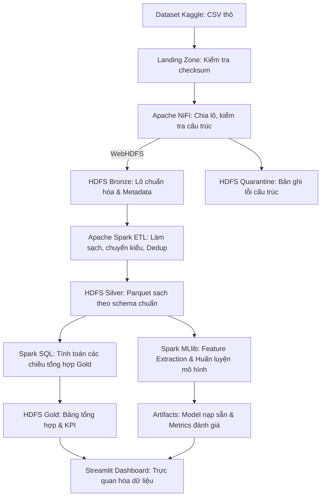

# KẾ HOẠCH ĐỒ ÁN MÔN HỌC: NHẬP MÔN BIG DATA
## ĐỀ TÀI: PHÂN TÍCH DỮ LIỆU ĐÁNH GIÁ TRÒ CHƠI TRÊN STEAM (STEAM REVIEWS ANALYTICS)

> [!IMPORTANT]
> **Ba yêu cầu cố định của đồ án — không thay thế khi điều chỉnh kế hoạch:**
> 1. **Đề tài:** Phân tích dữ liệu đánh giá trò chơi trên Steam.
> 2. **Công cụ luồng dữ liệu:** [Apache NiFi](https://nifi.apache.org/index.html) — là đường tiếp nhận duy nhất đưa dữ liệu vào HDFS (không nạp tay bằng `hdfs dfs -put` cho dữ liệu chính thức).
> 3. **Dataset:** [Steam Reviews Dataset 2021 — najzeko (Kaggle)](https://www.kaggle.com/datasets/najzeko/steam-reviews-2021/data) — mọi phân tích, mô hình và dashboard đều dùng dữ liệu từ bộ này (toàn bộ hoặc mẫu có manifest).
>
> Đề tài thuộc dạng **sinh viên tự đề xuất** (không có nguyên văn trong danh sách 15 đề tài gợi ý), nên phải được giảng viên xem xét, chấp thuận trong Tuần 1–3.

- **Quy mô nhóm:** 3 sinh viên (ký hiệu: **TV1**, **TV2**, **TV3**; sẽ thay bằng Họ tên & MSSV cụ thể).
- **Thời lượng:** Kế hoạch 10 tuần học phần theo quy định của môn học.
- **Công nghệ chủ đạo:** Apache NiFi, Hadoop HDFS, Apache Spark (PySpark DataFrame/SQL), Spark MLlib, Streamlit và Plotly.
- **Bộ dữ liệu mục tiêu:** [Steam Reviews Dataset 2021 — Kaggle](https://www.kaggle.com/datasets/najzeko/steam-reviews-2021/data) (theo mô tả của tác giả: ~21 triệu đánh giá, ~300 tựa game; số đếm thực tế đo lại sau khi tải — xem mục 3.3).
- **Trọng số điểm:** Đồ án thuộc phần CUỐI KỲ (chiếm **50% điểm học phần**), đánh giá qua 2 giai đoạn:
  - **Giai đoạn 1 (Tuần 6–7):** Báo cáo tiến độ, cơ sở lý thuyết, định hướng thực hiện (CLO1, CLO2) — chiếm **30% điểm đồ án**.
  - **Giai đoạn 2 (Tuần 9):** Báo cáo nội dung hoàn chỉnh đồ án, nộp toàn bộ sản phẩm (CLO5, CLO3, CLO4) — chiếm **70% điểm đồ án**.
  - **Thuyết trình & Demo (Tuần 10):** Báo cáo trước lớp bằng PPT và Demo trực tiếp sản phẩm.

---

## 1. Căn cứ quy định và Phân bố vai trò 3 thành viên

Căn cứ văn bản *"Yêu cầu chung và kế hoạch thực hiện đồ án môn Nhập môn Big Data"*:
- Mỗi nhóm gồm **đúng 3 sinh viên**.
- Quy định yêu cầu dùng **ít nhất một** công nghệ Big Data hoặc lưu trữ/xử lý phân tán (Hadoop, HDFS, Spark, Flink, NoSQL…). Nhóm chọn: **HDFS** để lưu trữ phân tán, **Apache Spark** để xử lý phân tán và học máy; ngoài ra theo yêu cầu cố định của đồ án dùng **Apache NiFi** để tiếp nhận, kiểm soát luồng dữ liệu (Data Ingestion), và **Streamlit** để trực quan hóa.
- Sản phẩm nộp trên Classroom bao gồm: **Source Code**, **File Word báo cáo**, **File PPT báo cáo**, kèm kịch bản Demo trực tiếp.

### Phân công trách nhiệm 3 thành viên

| Tiêu chí | TV1 — Kỹ sư Hạ tầng dữ liệu & Trực quan hóa | TV2 — Kỹ sư Xử lý dữ liệu lớn & Machine Learning | TV3 — Kỹ sư Chất lượng dữ liệu & Báo cáo |
|---|---|---|---|
| **Vai trò chính** | Data Platform & Application Engineer | Big Data Processing & ML Engineer | Data Quality & Documentation Engineer |
| **Hạ tầng & Thu thập** | • Quản lý Docker Compose cụm (Hadoop HDFS, Spark, NiFi).<br>• Thiết kế luồng NiFi: SplitRecord, CSVReader, WebHDFS, retry, manifest, quarantine. | • Khảo sát cấu trúc dataset gốc, đối chiếu schema, xây dựng data dictionary.<br>• Kiểm tra tính toàn vẹn dữ liệu và cơ chế partition trên HDFS. | • Hỗ trợ kiểm tra kết quả nạp dữ liệu vào HDFS.<br>• Xây dựng fixture kiểm thử và tài liệu minh chứng ingestion. |
| **Xử lý dữ liệu (ETL)** | • Hỗ trợ đo đạc hiệu năng I/O, giám sát tài nguyên HDFS/Worker. | • Xây dựng Spark ETL: chuẩn hóa kiểu, lọc null, dedup theo `review_id`, xử lý outlier.<br>• Tạo các bảng tổng hợp (Gold layer) tối ưu truy vấn. | • Viết test đối soát số liệu trước/sau ETL.<br>• Kiểm tra và xác nhận tính đúng đắn của dữ liệu Silver/Gold. |
| **Mô hình hóa (ML)** | • Tích hợp kết quả dự đoán và metrics vào giao diện hiển thị. | • Xây dựng baseline model (majority class).<br>• Xây dựng pipeline Spark MLlib (TF-IDF + Logistic Regression).<br>• Đánh giá mô hình (Macro-F1, PR-AUC, Confusion Matrix, Error Analysis). | • Hỗ trợ phân tích lỗi (~30 mẫu sai), soạn bảng đối sánh Baseline vs MLlib. |
| **Trực quan hóa & Báo cáo** | • Xây dựng Dashboard Streamlit (4 trang, 6+ biểu đồ Plotly).<br>• Chủ trì trình bày kịch bản Demo và tổng hợp slide PPT. | • Đối soát số liệu hiển thị trên Dashboard khớp với bảng Gold.<br>• Phân tích sâu 5+ phát hiện từ dữ liệu và đánh giá hạn chế mô hình. | • Soạn thảo báo cáo Word (Cơ sở lý thuyết, Kết luận, Tài liệu tham khảo, Phụ lục).<br>• Rà soát toàn bộ báo cáo đảm bảo đúng 10 mục bắt buộc và không lỗi chính tả. |
| **Trách nhiệm báo cáo** | Soạn thảo mục: Kiến trúc, Hạ tầng HDFS/NiFi, Dashboard, Hướng dẫn chạy. | Soạn thảo mục: Dữ liệu, Xử lý Spark, Cơ sở lý thuyết thuật toán, Kết quả ML. | Soạn thảo mục: Cơ sở lý thuyết Big Data, Kết luận & Định hướng, Tài liệu tham khảo, Phụ lục. |

---

## 2. Mục tiêu, Bài toán và Bộ câu hỏi phân tích

### 2.1. Mục tiêu
Xây dựng một hệ thống xử lý dữ liệu lớn khép kín, có khả năng tái lập: tiếp nhận dữ liệu đánh giá trò chơi Steam từ nguồn công khai, đưa vào lưu trữ phân tán HDFS qua Apache NiFi, làm sạch và tổng hợp bằng Apache Spark, huấn luyện mô hình dự đoán xu hướng khuyến nghị (`recommended`) bằng Spark MLlib, và trực quan hóa toàn diện trên giao diện Streamlit Dashboard.

### 2.2. Năm câu hỏi phân tích trọng tâm
1. **Xếp hạng & Tỷ lệ khuyến nghị:** Trò chơi nào nhận được nhiều đánh giá nhất, và tỷ lệ khuyến nghị thực tế là bao nhiêu? (Luôn đi kèm số lượng mẫu số để tránh thiên lệch).
2. **Xu hướng thời gian:** Số lượng đánh giá và tỷ lệ khuyến nghị biến động như thế nào theo các mốc thời gian (tháng/năm)?
3. **Phân bố ngôn ngữ:** Sự phân bổ các ngôn ngữ đánh giá ra sao và có sự khác biệt rõ rệt về mức độ hài lòng giữa các cộng đồng ngôn ngữ không?
4. **Thời lượng chơi & Đánh giá:** Thời gian chơi tại thời điểm viết đánh giá (`playtime_at_review`) có mối liên hệ như thế nào với quyết định khuyến nghị trò chơi?
5. **Khả năng dự đoán của nội dung:** Mô hình phân loại văn bản (Spark MLlib) dự đoán nhãn khuyến nghị dựa trên nội dung tiếng Anh có cải thiện vượt trội so với baseline đa số không?

---

## 3. Kiến trúc hệ thống và Quy trình phân tầng dữ liệu

Hệ thống được thiết kế theo nguyên lý **Clean Architecture** kết hợp mô hình dữ liệu đa tầng (**Medallion Architecture**):



### 3.1. Các tầng dữ liệu
- **Bronze (HDFS):** Lưu các lô dữ liệu thô nhận từ NiFi thông qua WebHDFS, kèm `batch_id`, timestamp và manifest kiểm soát.
- **Silver (HDFS - Parquet):** Dữ liệu sau khi làm sạch bằng Spark: loại bỏ bản ghi không hợp lệ, deduplication dựa trên `review_id` (chọn bản cập nhật mới nhất theo `updated_at`), định dạng chuẩn thời gian UTC và các kiểu số nguyên/thực.
- **Gold (HDFS - Parquet):** Các bảng tổng hợp phục vụ truy vấn tốc độ cao:
  - `quality_summary`: Số bản ghi đọc được, lỗi theo lý do, trùng lặp, thiếu văn bản/thời gian, số bản ghi sạch.
  - `game_summary`: Tổng hợp theo tựa game, số lượng đánh giá, số khuyến nghị, tỷ lệ.
  - `monthly_summary`: Tổng hợp theo game, năm/tháng, số lượng và xu hướng.
  - `language_summary`: Phân bố theo ngôn ngữ đánh giá.
  - `playtime_summary`: Phân nhóm thời lượng chơi (`<2h`, `2-10h`, `10-50h`, `50-100h`, `>100h`) và tỷ lệ tương ứng.
  - `model_metrics`: Bảng so sánh baseline vs Logistic Regression, ma trận nhầm lẫn (confusion matrix), Precision, Recall, Macro-F1.

Tỷ lệ khuyến nghị luôn tính bằng `recommended_count / valid_label_count`; mẫu số 0 hiển thị N/A. Khi gộp nhóm, cộng tử số và mẫu số rồi mới chia — không lấy trung bình các tỷ lệ từng lô/FlowFile.

### 3.2. Mức quy mô thử nghiệm (3 Tiers)
1. **Smoke Tier (~10.000 bản ghi):** Phục vụ kiểm thử nhanh luồng dữ liệu, test trường hợp CSV có xuống dòng, dấu nháy kép, ký tự Unicode đặc biệt.
2. **Core Tier (~1.000.000 bản ghi):** Mục tiêu chính để nạp vào cụm phân tán HDFS, chạy Spark ETL và huấn luyện mô hình MLlib (lấy mẫu chuẩn ngẫu nhiên có cố định seed).
3. **Full Tier (Toàn bộ dataset ~21 triệu bản ghi):** Chạy thử nghiệm đánh giá hiệu năng và khả năng mở rộng quy mô khi tài nguyên phần cứng cho phép.

Core là mục tiêu kỹ thuật của nhóm, không phải ngưỡng do quy định đặt ra. Mẫu lấy theo hash của `review_id` (không lấy máy móc 1 triệu dòng đầu); ghi seed, điều kiện lấy mẫu, phân bố game/ngôn ngữ/nhãn vào manifest. Báo cáo luôn nêu rõ kết quả thuộc Full hay subset.

### 3.3. Dataset Steam Reviews 2021 và hợp đồng dữ liệu v1

**Nguồn:** [Kaggle — najzeko/steam-reviews-2021](https://www.kaggle.com/datasets/najzeko/steam-reviews-2021/data). Metadata công khai ([API chi tiết](https://www.kaggle.com/api/v1/datasets/view/najzeko/steam-reviews-2021), truy cập 01/10/2026) mô tả khoảng 21 triệu đánh giá, khoảng 300 trò chơi, thu thập qua Steam API, phiên bản 1, giấy phép `GPL 2`. Đây là mô tả của tác giả, chưa phải số đếm của nhóm.

API chi tiết trả `totalBytes = 8.171.787.229`, còn [API danh sách](https://www.kaggle.com/api/v1/datasets/list?search=steam-reviews-2021) trả `3.193.406.910`; chưa xác định đâu là kích thước nén/giải nén. Sau khi tải (Tuần 1–3), TV2 ghi vào manifest: tên tệp, kích thước thực, SHA-256, số cột, số bản ghi, khoảng thời gian và phân bố ngôn ngữ.

Tên cột nguồn dưới đây là **dự kiến, phải đối chiếu header thực**; nếu khác, cập nhật bảng ánh xạ trong `schemas/source/`, không âm thầm bỏ cột bắt buộc.

| Cột nguồn dự kiến | Tên chuẩn/kiểu | Quy tắc |
|---|---|---|
| `review_id` | `review_id: string` | Khóa đánh giá; không dùng số dòng CSV làm ID. |
| `app_id`, `app_name` | `app_id: string`, `app_name: string` | ID bắt buộc cho phân tích theo game; tên thiếu có thể hiển thị ID. |
| `language` | `language: string` | Chuẩn hóa khoảng trắng/chữ thường; giữ nhóm `unknown` khi thiếu. |
| `review` | `review_text: string` | Giữ bản gốc; tạo bản chuẩn hóa riêng cho ML. |
| `recommended` | `recommended: boolean` | Chỉ chấp nhận ánh xạ đã công bố; không đổi thiếu/không hợp lệ thành `false`. |
| `timestamp_created`, `timestamp_updated` | `created_at`, `updated_at: timestamp` | Xác minh đơn vị thời gian; chuẩn hóa UTC; không ép ngày thiếu thành ngày hiện tại. |
| `author.playtime_at_review` | `playtime_at_review_minutes: double` | Kiểm tra đơn vị, số âm và null. |
| `author.playtime_forever` | `playtime_forever_minutes: double` | Giá trị tại lúc thu thập; không thay thế ngầm cho playtime tại thời điểm đánh giá. |
| `votes_helpful`, `votes_funny` | kiểu `long` | Dùng cho mô tả; không đưa vào mô hình văn bản. |
| (bổ sung khi tiếp nhận) | `dataset_version`, `batch_id`, `source_file`, `ingested_at` | Truy vết và chạy lại. |

Quy tắc xử lý:
- Bản ghi thiếu ID/game/nhãn hoặc lỗi cấu trúc đi vào quarantine kèm mã lý do. Tệp CSV không parse được đi nhánh lỗi cấp tệp.
- Đánh giá không có văn bản vẫn dùng cho thống kê nhãn nhưng loại khỏi tập ML và đếm riêng. Ngày thiếu chỉ loại khỏi biểu đồ thời gian.
- Dedup theo `review_id`; giữ `updated_at` mới nhất, có quy tắc phụ xác định khi bằng nhau/thiếu ngày; lưu số bản ghi trùng bị loại.
- Cột có dấu chấm (`author.*`) phải được tham chiếu/đổi tên đúng, không diễn giải là cấu trúc lồng nhau.
- Không xóa outlier thời gian chơi: giữ bản gốc, đánh dấu; biểu đồ có thể giới hạn trục kèm ghi chú.
- Nhãn `recommended` là nhãn **khuyến nghị nhị phân**, không phải cảm xúc ba lớp; không tự tạo lớp "trung lập". Nếu thiếu `playtime_at_review`, câu hỏi số 4 chuyển sang `playtime_forever` và ghi rõ giới hạn.
- Đối soát bắt buộc: `N_parseable = N_invalid_record + N_valid_pre_dedup`; `N_silver = N_valid_pre_dedup − N_duplicate_removed`; lỗi cấp tệp báo riêng.

### 3.4. Luồng Apache NiFi (TV1 chủ trì)

[Apache NiFi](https://nifi.apache.org/index.html) là thành phần bắt buộc, đảm nhiệm toàn bộ việc đưa dataset Kaggle vào HDFS. Dùng NiFi dòng 2.x (tài liệu Apache yêu cầu Java 21 — [NiFi README](https://github.com/apache/nifi/blob/main/README.md)); khóa phiên bản/image digest khi dựng cụm ở Tuần 4–5. Các processor/service tham chiếu tài liệu chính thức: [CSVReader](https://nifi.apache.org/components/org.apache.nifi.csv.CSVReader/), [SplitRecord](https://nifi.apache.org/components/org.apache.nifi.processors.standard.SplitRecord/), [InvokeHTTP](https://nifi.apache.org/components/org.apache.nifi.processors.standard.InvokeHTTP/).

1. **Landing:** tải/giải nén dataset bằng Kaggle CLI hoặc trình duyệt, lưu checksum. NiFi dùng `ListFile → FetchFile` đọc bản sao bất biến; chỉ công bố tệp hoàn tất vào landing bằng đổi tên để tránh đọc tệp đang tải dở.
2. **Chia lô:** `SplitRecord` với `CSVReader` và record writer; khởi đầu ~50.000 record/lô, tinh chỉnh theo số đo. Chốt encoding, header, quote, escape từ mẫu thực. Không cắt theo dòng vì review có thể chứa xuống dòng.
3. **Kiểm tra:** tách lỗi parse cấp tệp và lỗi cấu trúc cấp record. Landing giữ dữ liệu gốc; bronze lưu lô đã chuẩn hóa định dạng; luật làm sạch nghiệp vụ do Spark xử lý.
4. **Ghi HDFS qua WebHDFS:** `InvokeHTTP` thực hiện quy trình CREATE hai bước — PUT không nội dung để nhận vị trí DataNode, rồi PUT nội dung tới vị trí đó và kiểm tra mã tạo thành công ([WebHDFS CREATE](https://hadoop.apache.org/docs/stable/hadoop-project-dist/hadoop-hdfs/WebHDFS.html#Create_and_Write_to_a_File)). Kiểm tra redirect, hostname DataNode và cổng trong mạng container. Không giả định `PutHDFS` có sẵn ở mọi bản NiFi 2.x.
5. **Chạy lại an toàn:** `batch_id` = checksum nguồn + chỉ số lô + phiên bản schema; ghi vào đường dẫn tạm, kiểm tra rồi commit/rename. Manifest ghi số lô dự kiến/đã xong, số record, checksum, trạng thái. Chỉ phát hành dấu hoàn tất khi toàn bộ lô đã commit; Spark chỉ đọc đợt hoàn tất.
6. **Lỗi và tải:** retry tối đa 3 lần với lỗi kết nối/tạm thời rồi chuyển hàng đợi lỗi; lỗi schema không retry. Back pressure khởi đầu ~100 FlowFile hoặc 256 MB trên các queue giữa lô, điều chỉnh theo số đo.
7. **Bằng chứng:** export flow JSON vào `nifi/flows/`, tham số mẫu vào `nifi/parameters/`; ảnh processor/provenance, số lô vào–ra–lỗi, log thử gián đoạn HDFS và chạy lại lưu ở `docs/evidence/`. Replay không được làm tăng số review duy nhất ở silver.

Mỗi `batch_id` chỉ có một phiên ghi. Khi retry gặp tệp đích đã tồn tại, xác minh manifest/checksum trước khi coi là thành công; không ghi đè mù. Spark vẫn dedup; không tuyên bố hệ thống bảo đảm exactly-once.

### 3.5. Môi trường cụm và bố cục HDFS

- Docker Compose trên Linux/WSL2: 1 NiFi, 1 HDFS NameNode + 2 DataNode (replication 2), 1 Spark master + 2 worker, 1 dashboard. Cụm container trên một máy là mô phỏng nhiều nút; báo cáo nêu rõ giới hạn này.
- Dự trù 24–32 GB RAM, SSD trống 80–100 GB (đo lại khi dựng). Dung lượng cần = tệp tải + giải nén + NiFi content repository + HDFS có replication + Parquet + shuffle. Nếu chỉ có 16 GB: giảm mẫu, chạy NiFi/Spark/dashboard theo lượt.
- Bằng chứng phân tán: `hdfs dfsadmin -report`, `hdfs fsck` cho block/replication; Spark UI/event log cho task trên executor của cả 2 worker.
- Cổng Web UI phải không trùng nhau (ví dụ NiFi HTTPS `8443`, Spark master `8080`, NameNode `9870`).

```text
HDFS: /steam/bronze/<dataset_version>/<batch_id>/
      /steam/silver/<run_id>/
      /steam/gold/<run_id>/
      /steam/quarantine/<run_id>/
```

Phân vùng silver theo năm/tháng khi phù hợp dữ liệu thực; tránh chia nhỏ theo game × ngôn ngữ. Mỗi snapshot dashboard có `run_id`, schema version, phạm vi mẫu và thời điểm tạo; dashboard không trộn nhiều lần chạy.

---

## 4. Kế hoạch thực hiện chi tiết 10 tuần

Kế hoạch bám sát đề cương học phần, chia thành 5 chặng công việc:

### Tuần 1–3: Khởi động, Đăng ký đề tài & Lập kế hoạch chi tiết
- **Mục tiêu:** Thống nhất đề tài, thành lập nhóm 3 người, khảo sát sơ bộ dữ liệu, hoàn thiện kế hoạch 10 tuần và thiết lập repository.
- **Công việc TV1:**
  - Thiết lập Git repository, cấu trúc thư mục Clean Architecture, quy ước commit.
  - Khảo sát các công nghệ hạ tầng: Docker Compose, Apache NiFi, Hadoop HDFS, Spark.
  - Chuẩn bị dự thảo kế hoạch làm việc và phân công nhiệm vụ.
- **Công việc TV2:**
  - Khảo sát bộ dữ liệu Steam Reviews trên Kaggle (kiểm tra schema dự kiến, giấy phép, dung lượng).
  - Xác định bài toán nghiệp vụ, 5 câu hỏi phân tích và các độ đo đánh giá.
  - Cùng TV1 hoàn thiện bản kế hoạch chi tiết 10 tuần.
- **Công việc TV3:**
  - Nghiên cứu quy định đồ án, chuẩn mực báo cáo 10 mục và rubric đánh giá.
  - Xây dựng fixture kiểm thử CSV mẫu (multiline, unicode, dấu nháy kép) phục vụ kiểm tra parser.
  - Cùng TV1 & TV2 hoàn thiện bản kế hoạch chi tiết 10 tuần.
- **Sản phẩm cần đạt:** Đề tài được phê duyệt; Bản kế hoạch làm việc chi tiết của nhóm (`Plan.md`, `Checklist.md`).

### Tuần 4–5: Cơ sở lý thuyết, Thiết kế giải pháp & Dựng môi trường cụm
- **Mục tiêu:** Nghiên cứu lý thuyết các công nghệ sử dụng, thiết kế kiến trúc hệ thống, xây dựng môi trường cụm phân tán và thử nghiệm luồng dữ liệu mẫu.
- **Công việc TV1:**
  - Viết Docker Compose cho cụm: 1 NiFi, 1 HDFS NameNode + 2 DataNodes, 1 Spark Master + 2 Workers.
  - Kiểm tra kết nối WebHDFS từ NiFi; xây dựng luồng tiếp nhận mẫu (ListFile → SplitRecord → WebHDFS).
  - Soạn thảo cơ sở lý thuyết về Hadoop HDFS, cơ chế lưu trữ phân tán block/replication và Apache NiFi.
- **Công việc TV2:**
  - Nghiên cứu cơ sở lý thuyết về Apache Spark (RDD, DataFrame, Spark SQL, Spark MLlib).
  - Nghiên cứu thuật toán phân loại văn bản: TF-IDF, mô hình phân lớp Logistic Regression, các độ đo Macro-F1, Precision, Recall, PR-AUC.
  - Xây dựng schema ban đầu (`schemas/source/`, `schemas/silver/`, `schemas/gold/`).
  - Viết ví dụ minh họa và tài liệu tóm tắt lý thuyết thuật toán.
- **Công việc TV3:**
  - Soạn thảo cơ sở lý thuyết về Big Data (khái niệm, đặc trưng V, hệ sinh thái).
  - Thiết kế khung báo cáo Word đầy đủ 10 mục theo quy định.
  - Xây dựng bộ fixture kiểm thử đa dạng (các case CSV lỗi) hỗ trợ TV1 kiểm tra luồng NiFi.
- **Sản phẩm cần đạt:** Tài liệu tóm tắt cơ sở lý thuyết thuật toán; Cụm container HDFS/Spark/NiFi chạy thông suốt ở mức smoke test.

### Tuần 6–7: Xây dựng Baseline, Đánh giá sơ bộ & BÁO CÁO TIẾN ĐỘ (Giai đoạn 1)
- **Mục tiêu:** Hoàn thành tiền xử lý dữ liệu cơ bản, xây dựng mô hình baseline, đánh giá sơ bộ và hoàn thành báo cáo tiến độ Giai đoạn 1 (chiếm 30% điểm đồ án, đánh giá theo CLO1, CLO2).
- **Công việc TV1:**
  - Hoàn thiện luồng NiFi có chia lô (batching), xử lý lỗi (quarantine queue), retry có giới hạn và ghi nhận manifest.
  - Nạp dữ liệu vào HDFS bronze; chụp ảnh minh chứng hoạt động của NameNode, 2 DataNodes và NiFi Data Provenance.
  - Phác thảo wireframe và khung giao diện Streamlit Dashboard (`src/steam_reviews/presentation/dashboard/`).
  - Tổng hợp slide báo cáo tiến độ Giai đoạn 1.
- **Công việc TV2:**
  - Viết job Spark ETL đọc dữ liệu từ HDFS, làm sạch dữ liệu, lọc bỏ nhãn rác, xử lý giá trị thiếu.
  - Chia tập dữ liệu train/validation/test cố định seed (tránh rò rỉ dữ liệu qua văn bản trùng).
  - Xây dựng mô hình Baseline (dự đoán lớp đa số); tính toán các độ đo sơ bộ ban đầu trên validation set.
  - Xác định các điểm cần cải thiện cho mô hình Spark MLlib ở giai đoạn sau.
  - Soạn thảo nội dung Báo cáo tiến độ Giai đoạn 1 (mục Giới thiệu đề tài, Cơ sở lý thuyết, Dữ liệu và Thiết kế hệ thống).
- **Công việc TV3:**
  - Viết test đối soát số liệu sau ETL (số bản ghi trước/sau làm sạch, dedup).
  - Soạn thảo mục Cơ sở lý thuyết Big Data và mục Giới thiệu đề tài trong báo cáo Word.
  - Hỗ trợ TV1 rà soát và tổng hợp slide báo cáo tiến độ Giai đoạn 1.
- **Sản phẩm cần đạt:**
  - Kết quả đánh giá sơ bộ mô hình baseline và hướng cải thiện.
  - **Hồ sơ Báo cáo tiến độ Giai đoạn 1 hoàn chỉnh** (nộp theo yêu cầu giảng viên).

### Tuần 8–9: Hoàn thiện Pipeline, Tối ưu MLlib, Trực quan hóa & BÁO CÁO HOÀN CHỈNH (Giai đoạn 2)
- **Mục tiêu:** Hoàn thiện toàn bộ pipeline từ NiFi đến Dashboard, tối ưu mô hình Spark MLlib, phân tích lỗi, hoàn thiện báo cáo hoàn chỉnh (chiếm 70% điểm đồ án, đánh giá theo CLO5, CLO3, CLO4) và nộp trên Classroom.
- **Công việc TV1:**
  - Hoàn thiện ứng dụng Dashboard Streamlit với 4 trang đầy đủ:
    1. *Tổng quan:* Thống kê toàn cảnh, số lượng game, phân bố đánh giá và ngôn ngữ.
    2. *Khám phá trò chơi:* Bảng xếp hạng game, tỷ lệ khuyến nghị kèm ngưỡng lọc số lượng đánh giá, xu hướng theo thời gian.
    3. *Thời lượng chơi & Chất lượng:* Tương quan giữa giờ chơi và khuyến nghị, thống kê tỷ lệ bản ghi thiếu/trùng lặp/lỗi.
    4. *Hiệu năng mô hình:* So sánh trực quan Baseline vs Logistic Regression, ma trận nhầm lẫn, biểu đồ PR-AUC, kiểm thử dự đoán mẫu.
  - Đo đạc hiệu năng cụm (tốc độ xử lý, thời gian ETL, giám sát tài nguyên 1 worker vs 2 workers).
  - Soạn thảo phần Xây dựng ứng dụng, trực quan hóa và hướng dẫn cài đặt/vận hành hệ thống.
  - Tổng hợp toàn bộ slide thuyết trình cuối kỳ (.pptx).
- **Công việc TV2:**
  - Hoàn thiện pipeline Spark MLlib: Tokenizer, StopWordsRemover, HashingTF, IDF, LogisticRegression.
  - Tinh chỉnh siêu tham số trên validation set; đánh giá độc lập lần cuối trên test set (tuyệt đối không leak test set).
  - Thực hiện Error Analysis trên ~30 mẫu dự đoán sai (văn bản mỉa mai, đánh giá ngắn, tiếng lóng).
  - Xây dựng hoàn chỉnh các bảng Gold summaries trên HDFS/Parquet, xuất snapshot phục vụ Dashboard.
  - Soạn thảo mục Kết quả thực nghiệm, Phân tích dữ liệu, Đánh giá mô hình và Hạn chế của giải pháp trong báo cáo Word.
- **Công việc TV3:**
  - Soạn thảo mục Kết luận & Định hướng phát triển, Tài liệu tham khảo và Phụ lục (hướng dẫn cài đặt) trong báo cáo Word.
  - Rà soát toàn bộ báo cáo Word đảm bảo đúng **10 mục bắt buộc**, không lỗi chính tả, số liệu nhất quán.
  - Hỗ trợ TV2 soạn bảng đối sánh Baseline vs Logistic Regression và phân tích lỗi.
- **Công việc chung Tuần 9:**
  - Rà soát toàn diện báo cáo Word theo đúng **10 mục bắt buộc** trong quy định.
  - Kiểm thử độc lập: TV1 chạy lại toàn bộ mã nguồn của TV2 trên môi trường sạch; TV2 kiểm tra chéo các số liệu trên Dashboard của TV1; TV3 đối soát số liệu báo cáo với kết quả thực tế.
  - **Nộp đầy đủ trên Classroom:** Source Code, File Word báo cáo hoàn chỉnh, File PPT báo cáo.
- **Sản phẩm cần đạt:**
  - Bộ dữ liệu đã qua tiền xử lý, sẵn sàng huấn luyện.
  - Toàn bộ source code chạy ổn định, không lỗi.
  - Dashboard tương tác trực quan hoàn chỉnh.
  - File Word báo cáo hoàn chỉnh và Slide PPT.
  - Bằng chứng nộp bài đầy đủ trên Classroom.

### Tuần 10: Báo cáo, Thuyết trình & Demo sản phẩm trước lớp
- **Mục tiêu:** Thuyết trình tự tin, mạch lạc trước lớp; Demo trực tiếp hệ thống hoạt động ổn định; trả lời tốt các câu hỏi phản biện của giảng viên.
- **Công việc thực hiện:**
  - Diễn tập thuyết trình chung (thời lượng 8–10 phút theo yêu cầu giảng viên). Cả 3 thành viên đều tham gia trình bày phần công việc phụ trách.
  - Chuẩn bị môi trường demo trực tiếp (chạy các container cụm, thực thi luồng NiFi, hiển thị Dashboard tương tác).
  - Chuẩn bị video quay demo dự phòng chất lượng cao và dữ liệu snapshot offline phòng sự cố mạng/máy móc.
  - Chuẩn bị trả lời phản biện: giải thích cơ chế phân tán của HDFS/Spark, lý do chọn mô hình, cơ chế chống rò rỉ dữ liệu, giải thích các số liệu bất thường.
- **Sản phẩm cần đạt:** Buổi thuyết trình hoàn chỉnh, đúng thời gian quy định; trả lời xuất sắc câu hỏi phản biện.

---

## 5. Ma trận chuẩn hóa theo Rubric đánh giá (Thang điểm 10)

Kế hoạch bám sát bảng Rubric đánh giá đồ án cuối kỳ gồm 6 tiêu chí:

| Tiêu chí đánh giá | Chuẩn đầu ra (CLO) | Điểm tối đa | Bằng chứng và sản phẩm thực hiện của nhóm | Phụ trách chính |
|---|:---:|:---:|---|:---:|
| **1. Tính ứng dụng của kĩ thuật** | CLO1 | 1.0 đ | • Bài toán phân tích đánh giá Steam gắn liền với thực tế ngành công nghiệp game.<br>• Trả lời 5 câu hỏi nghiệp vụ rõ ràng, rút ra ít nhất 5 nhận xét giá trị đi kèm số liệu xác thực và đề xuất giải pháp. | TV1 + TV2 + TV3 |
| **2. Lưu trữ và xử lý dữ liệu / phân tích dữ liệu** | CLO2 | 2.0 đ | • Cụm Hadoop HDFS lưu trữ phân tán dữ liệu thực tế (chứng minh qua blocks, replication, NameNode/DataNodes).<br>• Luồng thu thập tự động qua Apache NiFi có chia lô, retry, quarantine.<br>• Pipeline Spark ETL xử lý phân tán: làm sạch, dedup, chuẩn hóa kiểu, chuyển đổi sang Parquet tầng Silver/Gold. | TV1 (Hạ tầng, NiFi, HDFS)<br>TV2 (Spark ETL, Data)<br>TV3 (Kiểm thử, Đối soát) |
| **3. Mô hình / công nghệ xử lý bài toán** | CLO3 | 2.5 đ | • Xây dựng mô hình Baseline đa số chuẩn mực để đối sánh.<br>• Xây dựng pipeline Spark MLlib (TF-IDF + Logistic Regression).<br>• Đánh giá mô hình khách quan qua Macro-F1, Precision, Recall, PR-AUC, Confusion Matrix.<br>• Phân tích lỗi (Error Analysis) và chỉ rõ các hạn chế kỹ thuật. | TV2 (chủ trì)<br>TV3 (hỗ trợ) |
| **4. Trực quan hóa / Xây dựng ứng dụng** | CLO3 | 2.5 đ | • Dashboard tương tác Streamlit 4 trang hoàn chỉnh, bố cục khoa học.<br>• Tối thiểu 6 biểu đồ trực quan hóa dữ liệu có ý nghĩa (Plotly).<br>• Hỗ trợ bộ lọc tương tác (game, ngôn ngữ, thời gian); xử lý trạng thái rỗng an toàn. | TV1 (UI/Dashboard)<br>TV2 (Dữ liệu Gold)<br>TV3 (Đối soát số liệu) |
| **5. Trình bày báo cáo** | CLO4 | 1.0 đ | • Báo cáo Word tuân thủ chính xác cấu trúc 10 mục bắt buộc, trình bày chuẩn mực, không lỗi chính tả.<br>• Slide PPT thiết kế chuyên nghiệp, mạch lạc.<br>• Thuyết trình đúng giờ, kịch bản demo rõ ràng, trả lời tốt câu hỏi phản biện. | TV1 + TV2 + TV3 |
| **6. Phân công và phối hợp làm việc nhóm** | CLO5 | 1.0 đ | • Bảng phân công chi tiết, cân đối khối lượng công việc giữa 3 thành viên.<br>• Nhật ký làm việc hàng tuần, minh chứng commit Git và review chéo giữa 3 bạn.<br>• Tinh thần trách nhiệm cao, giải quyết vấn đề hiệu quả. | TV1 + TV2 + TV3 |
| **TỔNG CỘNG** | | **10.0 đ** | | |

---

## 6. Cấu trúc chuẩn 10 mục của Báo cáo Word (.docx)

File Word báo cáo cuối kỳ bắt buộc phải tuân theo đúng thứ tự 10 mục sau:

1. **Trang bìa:** Thông tin Trường, Khoa, Môn học, Tên đề tài, Giảng viên hướng dẫn, Thông tin 3 sinh viên thực hiện (Họ tên, MSSV, Lớp).
2. **Lịch làm việc nhóm trong hàng tuần:** Tiến độ thực tế từ Tuần 1 đến Tuần 10.
3. **Công việc mỗi thành viên trong nhóm:** Bảng chi tiết phân công, sản phẩm hoàn thành, tỷ lệ đóng góp (≈ 33% - 33% - 34%).
4. **Mục lục:** Danh mục các chương mục, danh mục bảng biểu và hình ảnh.
5. **Giới thiệu đề tài:** Bối cảnh, mục tiêu, đối tượng sử dụng, phạm vi dữ liệu, 5 câu hỏi phân tích và giá trị thực tiễn.
6. **Cơ sở lý thuyết:**
   - Khái niệm dữ liệu lớn và các đặc trưng V.
   - Hệ sinh thái Big Data: Hadoop HDFS, Apache Spark (DataFrame, SQL, MLlib), Apache NiFi.
   - Lý thuyết xử lý ngôn ngữ tự nhiên: TF-IDF, Logistic Regression, các độ đo đánh giá phân loại.
7. **Xây dựng ứng dụng, trực quan hóa dữ liệu:**
   - Khảo sát bộ dữ liệu, mô tả thuộc tính và data dictionary.
   - Thiết kế kiến trúc tổng thể Clean Architecture và luồng dữ liệu Medallion (Bronze - Silver - Gold).
   - Quy trình thu thập qua NiFi và lưu trữ phân tán trên HDFS.
   - Quy trình tiền xử lý, làm sạch và tổng hợp dữ liệu bằng PySpark.
   - Xây dựng mô hình máy học Spark MLlib, kết quả thực nghiệm và phân tích lỗi.
   - Thiết kế và tính năng của ứng dụng Streamlit Dashboard.
8. **Kết luận định hướng phát triển:** Tổng kết kết quả đạt được, đối chiếu mục tiêu ban đầu, bài học kinh nghiệm và hướng mở rộng.
9. **Tài liệu tham khảo:** Dẫn nguồn tài liệu khoa học, documentation chính thức của Apache, Kaggle dataset.
10. **Phụ lục (nếu có):** Hướng dẫn cài đặt và chạy hệ thống, cấu hình tham số, các mẫu truy vấn đối soát dữ liệu.

---

## 7. Quản trị rủi ro trong quá trình thực hiện

| Rủi ro tiềm ẩn | Mức độ | Biện pháp phòng ngừa và xử lý | Người phụ trách |
|---|:---:|---|:---:|
| Tài nguyên máy tính cá nhân không đủ RAM để chạy đồng thời HDFS + Spark + NiFi | Cao | Sử dụng cấu hình container tinh giản (giới hạn bộ nhớ JVM); chạy theo giai đoạn (ingest xong dừng NiFi, sau đó chạy Spark); ưu tiên test trên tập Core Tier (~1M dòng). | TV1 |
| CSV chứa dữ liệu lỗi, nhiều dòng (multiline), dấu quote bị hỏng làm vỡ parser | Trung bình | Sử dụng `CSVReader` theo chuẩn Record trong NiFi; xây dựng fixture kiểm thử với các trường hợp ngoại lệ; đẩy bản ghi hỏng vào Quarantine queue. | TV1 + TV3 |
| Rò rỉ dữ liệu (Data Leakage) giữa các tập train/test trong bài toán văn bản | Cao | Chia tập dữ liệu dựa trên hash của nội dung văn bản (đảm bảo các review trùng nội dung hoàn toàn nằm cùng 1 tập); chỉ fit TF-IDF trên tập train. | TV2 |
| Lệch số liệu giữa Dashboard và kết quả xử lý của Spark | Trung bình | Sử dụng chung `run_id` cho mỗi lần xử lý; chốt grain của bảng Gold; viết test đối soát độc lập ít nhất 3 tổ hợp filter. | TV1 + TV2 + TV3 |
| Lỗi mạng hoặc sự cố phần cứng trong buổi thuyết trình & Demo | Trung bình | Xuất bản snapshot dữ liệu tĩnh cục bộ; chuẩn bị video quay sẵn toàn bộ quy trình demo ở độ phân giải cao; chuẩn bị slide chi tiết có ảnh chụp minh chứng. | TV1 |
