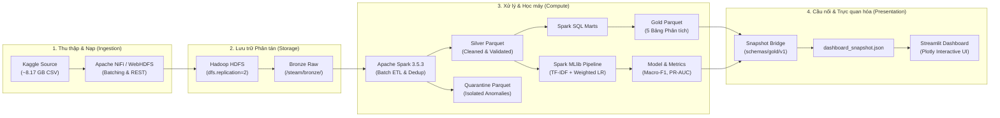
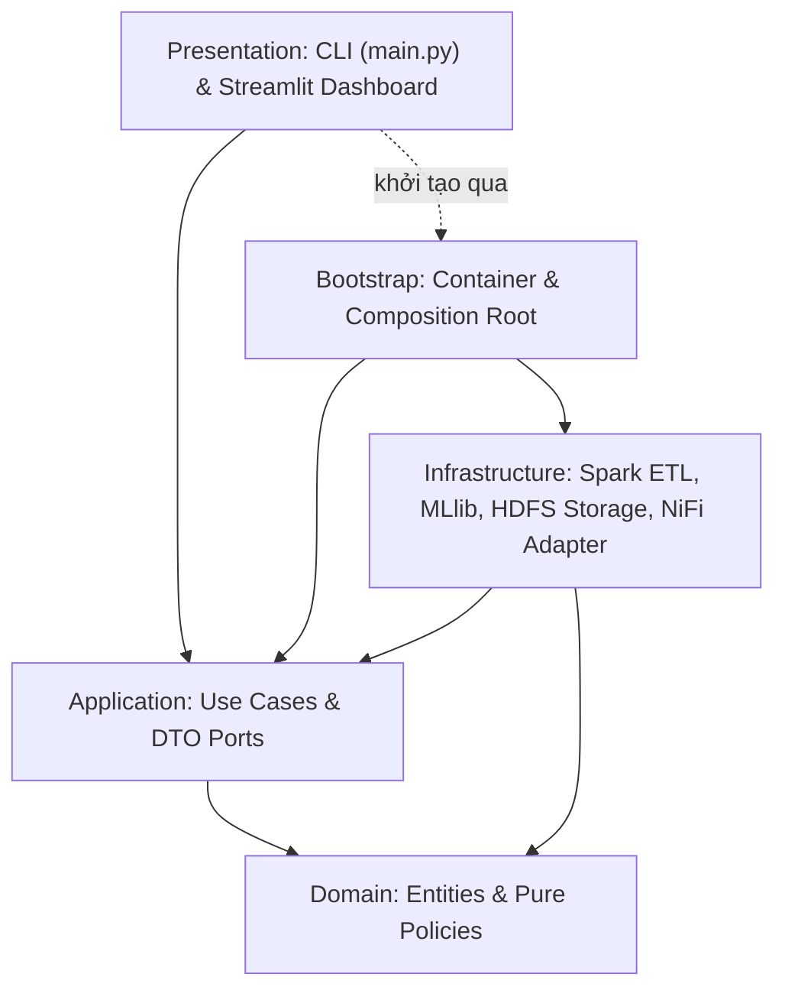
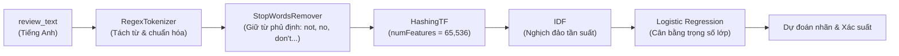

# Phân tích dữ liệu đánh giá trò chơi trên Steam (Steam Reviews Big Data Analytics)

[](https://www.python.org/downloads/)
[](https://spark.apache.org/)
[](https://hadoop.apache.org/)
[](https://nifi.apache.org/)
[](https://streamlit.io/)
[](docs/architecture.md)
[](tests/)

Đồ án môn học **Nhập môn Big Data** dành cho **nhóm 3 sinh viên (TV1, TV2, TV3)**, thực hiện theo kế hoạch chuẩn 10 tuần.  
Hệ thống xử lý phân tán khép kín theo luồng: **Kaggle Dataset (21,7+ triệu bản ghi) → Apache NiFi (WebHDFS Ingestion) → Hadoop HDFS phân tán → Apache Spark (PySpark ETL Medallion & MLlib) → Snapshot Bridge → Streamlit Interactive Dashboard**.

---

> [!IMPORTANT]
> **Ba yêu cầu cố định của đồ án (Bảo toàn trong suốt 10 tuần):**
> 1. **Đề tài:** Phân tích dữ liệu đánh giá trò chơi trên Steam (*Steam Reviews Analytics*).
> 2. **Công cụ thu thập dữ liệu (Ingestion):** [Apache NiFi](https://nifi.apache.org/index.html) — đường tiếp nhận duy nhất đưa dataset vào HDFS ([thiết kế luồng](Plan.md#34-luồng-apache-nifi-tv1-chủ-trì), [thư mục `nifi/`](nifi/README.md), [kịch bản nạp WebHDFS](scripts/README.md)).
> 3. **Dataset chính thức:** [Steam Reviews Dataset 2021 — najzeko (Kaggle)](https://www.kaggle.com/datasets/najzeko/steam-reviews-2021/data) — quy mô **21.747.371 dòng (~8,17 GB CSV)** ([hợp đồng dữ liệu](Plan.md#33-dataset-steam-reviews-2021-và-hợp-đồng-dữ-liệu-v1), [tài liệu đặc tả dữ liệu](docs/data/03_data_dictionary.md)).

---

## Mục lục

1. [Tổng quan Đề tài & Bài toán](#1-tổng-quan-đề-tài--bài-toán)
2. [Kiến trúc Tổng thể & Công nghệ](#2-kiến-trúc-tổng-thể--công-nghệ)
3. [Mô hình Dữ liệu Đa tầng (Medallion Architecture)](#3-mô-hình-dữ-liệu-đa-tầng-medallion-architecture)
4. [Quy trình Học máy (Spark MLlib Pipeline)](#4-quy-trình-học-máy-spark-mllib-pipeline)
5. [Giao diện Trực quan hóa (Streamlit Dashboard)](#5-giao-diện-trực-quan-hóa-streamlit-dashboard)
6. [Kết quả Thực nghiệm & Đối soát Số liệu](#6-kết-quả-thực-nghiệm--đối-soát-số-liệu)
7. [Cấu trúc Thư mục Dự án](#7-cấu-trúc-thư-mục-dự-án)
8. [Hướng dẫn Cài đặt & Vận hành (Runbook)](#8-hướng-dẫn-cài-đặt--vận-hành-runbook)
9. [Phân công Trách nhiệm Nhóm (3 Sinh viên)](#9-phân-công-trách-nhiệm-nhóm-3-sinh-viên)
10. [Tài liệu Liên quan](#10-tài-liệu-liên-quan)

---

## 1. Tổng quan Đề tài & Bài toán

### 1.1. Bối cảnh & Mục tiêu
Steam là nền tảng phân phối trò chơi điện tử kỹ thuật số lớn nhất thế giới với hàng chục triệu người dùng hoạt động mỗi ngày. Ý kiến đánh giá của người chơi (Reviews) không chỉ phản ánh chất lượng sản phẩm mà còn chứa đựng thông tin phong phú về tâm lý game thủ, các vấn đề kỹ thuật, cân bằng gameplay và mức độ gắn kết theo thời gian.

**Mục tiêu của đồ án:**
- Thiết lập hạ tầng lưu trữ và xử lý dữ liệu lớn phân tán có khả năng co giãn và chịu lỗi.
- Xử lý và làm sạch bộ dữ liệu khổng lồ **21,7+ triệu bản ghi**, giải quyết các thách thức đặc thù: văn bản nhiều dòng (multiline RFC 4180), ký tự Unicode đa ngôn ngữ, dữ liệu trùng lặp và thiếu giá trị.
- Tổng hợp các báo cáo phân tích đa chiều (Marts) phục vụ doanh nghiệp và nhà phát triển game.
- Xây dựng mô hình học máy phân tán (Spark MLlib) dự đoán khả năng khuyến nghị của người chơi dựa trên nội dung đánh giá dạng văn bản, cải thiện vượt trội so với baseline đa số.
- Cung cấp giao diện dashboard trực quan hóa tương tác theo thời gian thực với độ trễ thấp.

### 1.2. Năm câu hỏi phân tích trọng tâm
1. **Xếp hạng & Tỷ lệ khuyến nghị (Game Rankings):** Những trò chơi nào nhận được nhiều đánh giá nhất, và tỷ lệ khuyến nghị thực tế (`recommended_rate`) của từng tựa game là bao nhiêu?
2. **Xu hướng thời gian (Temporal Trends):** Khối lượng đánh giá và mức độ hài lòng của cộng đồng biến động như thế nào qua các năm và các tháng cao điểm?
3. **Phân bố ngôn ngữ (Language Diversity):** Sự phân bổ của 28 ngôn ngữ đánh giá ra sao, và mức độ hài lòng giữa các cộng đồng ngôn ngữ có sự phân hóa như thế nào?
4. **Mối tương quan giữa Thời gian chơi & Đánh giá (Playtime Correlation):** Thời lượng đã chơi (`author_playtime_forever` và `author_playtime_at_review`) có mối liên hệ như thế nào với xu hướng đánh giá tích cực hay tiêu cực?
5. **Năng lực dự đoán từ văn bản (NLP Prediction):** Mô hình Machine Learning trên Spark có thể dự đoán chính xác nhãn `recommended` dựa trên văn bản đánh giá tiếng Anh hay không, và cải thiện Macro-F1 bao nhiêu so với baseline?

---

## 2. Kiến trúc Tổng thể & Công nghệ

### 2.1. Luồng dữ liệu End-to-End Pipeline



### 2.2. Kiến trúc Phần mềm (Clean Architecture)
Hệ thống tuân thủ chặt chẽ **Clean Architecture** nhằm tách biệt hoàn toàn logic nghiệp vụ với framework hạ tầng:



- **Domain (`src/steam_reviews/domain/`):** Chứa các thực thể cốt lõi (`Review`, `DatasetReference`, `RunId`) và chính sách nghiệp vụ thuần túy Python (`CleaningPolicy`, `DedupPolicy`, `PlaytimePolicy`, `SplitPolicy`, `MetricsPolicy`). Không phụ thuộc bất kỳ thư viện bên ngoài hay Spark/HDFS.
- **Application (`src/steam_reviews/application/`):** Khai báo các giao diện trừu tượng (`Ports`), cấu trúc dữ liệu (`DTO`) và các kịch bản thực thi (`Use Cases`: `CleanReviews`, `BuildAnalytics`, `PrepareModelData`, `TrainModel`, `EvaluateModel`, `ExportDashboardSnapshot`).
- **Infrastructure (`src/steam_reviews/infrastructure/`):** Triển khai các cổng trừu tượng bằng công nghệ thực tế: PySpark DataFrame/SQL, Spark MLlib, WebHDFS REST Client, JSON Storage Recorder.
- **Presentation (`src/steam_reviews/presentation/`):** Điểm giao tiếp đầu cuối gồm bộ lệnh dòng lệnh CLI (`cli/main.py`) và ứng dụng Web UI (`dashboard/app.py`).
- **Bootstrap (`src/steam_reviews/bootstrap/`):** Composition root chịu trách nhiệm đọc cấu hình và tiêm phụ thuộc (Dependency Injection) giữa các tầng.

### 2.3. Cụm Hạ tầng Container (Docker Compose)
Toàn bộ hạ tầng được đóng gói trong [infra/docker/docker-compose.yml](infra/docker/docker-compose.yml) gồm 7 dịch vụ:

| Dịch vụ | Image | Port ánh xạ | Vai trò |
|---|---|---|---|
| `hdfs-namenode` | `apache/hadoop:3.3.6` | `9870`, `9000` | Quản lý metadata HDFS, cung cấp WebHDFS REST API |
| `hdfs-datanode-1` | `apache/hadoop:3.3.6` | `9864`, `9866` | Lưu trữ block phân tán (Node 1) |
| `hdfs-datanode-2` | `apache/hadoop:3.3.6` | `9865`, `9867` | Lưu trữ block phân tán (Node 2, replication=2) |
| `spark-master` | `bitnami/spark:3.5.3` | `8080`, `7077` | Điều phối tính toán phân tán Spark Cluster |
| `spark-worker-1` | `bitnami/spark:3.5.3` | `8081` | Worker xử lý dữ liệu Spark (2 Cores, 2 GB RAM) |
| `spark-worker-2` | `bitnami/spark:3.5.3` | `8082` | Worker xử lý dữ liệu Spark (2 Cores, 2 GB RAM) |
| `nifi` | `apache/nifi:2.0.0` | `8443` | Thu thập, phân lô và nạp streaming dữ liệu |

---

## 3. Mô hình Dữ liệu Đa tầng (Medallion Architecture)

Dữ liệu di chuyển qua các tầng theo mô hình Medallion tiêu chuẩn:

### 3.1. Tầng Bronze (Raw Storage)
- **Vị trí lưu trữ:** HDFS `/steam/bronze/{sample|core|full}/batch_*.csv`.
- **Cơ chế nạp:** Nạp dữ liệu qua WebHDFS REST API (`op=CREATE` kết hợp xử lý mã chuyển hướng `307 Temporary Redirect` đến DataNode).
- **Phân lô chống tràn RAM:** Phân tách dữ liệu streaming an toàn theo định dạng RFC 4180 (xử lý chính xác các trường text chứa dấu phẩy, dấu nháy kép và ký tự xuống dòng `\n`).

### 3.2. Tầng Silver (Cleaned & Conformed)
- **Vị trí lưu trữ:** `data/lake/silver/{run_id}/` (hoặc HDFS `/steam/silver/`) dạng nén Snappy Parquet.
- **Quy tắc làm sạch & chuẩn hóa:**
  1. Ép kiểu dữ liệu nghiêm ngặt (`review_id: Long`, `app_id: Int`, `recommended: Boolean`, `author_playtime_forever: Double`, timestamps).
  2. Cách ly các bản ghi bất thường vào `Quarantine` (thiếu `review_id`, `app_id <= 0`, nhãn ngoài `{0, 1}`).
  3. **Khử trùng lặp triệt để (Dedup):** Sử dụng hàm cửa sổ `ROW_NUMBER() OVER (PARTITION BY review_id ORDER BY timestamp_updated DESC, timestamp_created DESC)` để giữ lại bản ghi cập nhật mới nhất. Xử lý triệt để **134.927 bản ghi trùng lặp** từ cụm dữ liệu Hollow Knight.
  4. Quản lý text rỗng: Gắn cờ bản ghi đánh giá rỗng (34.297 dòng) để giữ lại cho phân tích tần suất nhưng loại khỏi tập huấn luyện ML.

### 3.3. Tầng Gold (Business Analytics Marts)
Tổng hợp sẵn 5 bảng Parquet phục vụ truy vấn tức thì:
1. **`game_summary`:** Tổng số đánh giá, số lượng khuyến nghị, tỷ lệ `recommended_rate`, trung bình thời gian chơi cho 315 tựa game.
2. **`monthly_summary`:** Xu hướng đánh giá và tỷ lệ hài lòng theo từng tháng từ năm 2010 đến 2021.
3. **`language_summary`:** Thống kê phân bố đánh giá trên 28 ngôn ngữ toàn cầu.
4. **`playtime_summary`:** Thống kê đánh giá theo các nhóm thời lượng chơi (dưới 2h, 2-10h, 10-50h, 50-100h, trên 100h).
5. **`quality_summary`:** Bảng đối soát số liệu kiểm tra chất lượng (V1 - V4).

---

## 4. Quy trình Học máy (Spark MLlib Pipeline)

### 4.1. Bài toán & Mục tiêu
Dự đoán nhãn nhị phân `recommended` (1: Khuyến nghị, 0: Không khuyến nghị) từ nội dung văn bản (`review_text`) của người chơi (ngôn ngữ tiếng Anh).

### 4.2. Kiến trúc Pipeline


### 4.3. Chống rò rỉ dữ liệu (No Data Leakage)
- **Phân chia tất định bằng Hash:** Phân tập theo `pmod(xxhash64(seed, normalize(review_text)), 10000)`:
  - **Train:** 70%
  - **Validation:** 15%
  - **Test:** 15%
- Các bài đánh giá có nội dung giống hệt nhau (ví dụ các meme ngắn "good game", "10/10") được gom hoàn toàn vào cùng một tập, đảm bảo **0% rò rỉ dữ liệu giữa tập huấn luyện và kiểm thử**.
- Toàn bộ tham số IDF và Logistic Regression chỉ được `fit` trên tập Train.

### 4.4. Giải quyết Mất cân bằng Nhãn
Dataset có tỷ lệ đánh giá tích cực áp đảo (~89,3% nhãn 1). Nhóm triển khai cơ chế cân bằng trọng số nghịch đảo tần suất lớp:
$$\text{weight}(c) = \frac{N}{2 \times N_c}$$
Giúp mô hình tăng mạnh độ nhạy (`Recall`) đối với lớp tiêu cực (nhãn 0) từ **0.00%** lên **64.19%** mà không làm sụt giảm độ chính xác tổng thể.

---

## 5. Giao diện Trực quan hóa (Streamlit Dashboard)

Dashboard được thiết kế theo phong cách hiện đại **Cyber-Industrial Telemetry** (Dark theme cao cấp, HUD Metric Cards, biểu đồ Plotly tương tác mượt mà), chia thành 4 phân hệ:

1. **Tab 1: Tổng quan Hệ thống (System Overview):**
   - KPI cốt lõi: Tổng số bản ghi xử lý, số tựa game, số ngôn ngữ, tỷ lệ khuyến nghị bình quân.
   - Biểu đồ phân bố đánh giá theo ngôn ngữ và phân tích độ dài bài đánh giá.
   - Bộ lọc đa chiều theo Game và Ngôn ngữ.
2. **Tab 2: Khám phá Trò chơi (Game Exploration):**
   - Bảng xếp hạng Top game được yêu thích nhất và Top game gây thất vọng nhất (kèm điều kiện mẫu số tối thiểu).
   - Xu hướng đánh giá theo dòng thời gian (2010 – 2021) phát hiện các đợt biến động tâm lý người chơi.
3. **Tab 3: Chất lượng & Thời lượng chơi (Playtime & Data Quality):**
   - Biểu đồ phễu Medallion: Đối soát dữ liệu đầu vào, tỷ lệ giữ lại (Retention Rate: 99.38%), phân loại nguyên nhân cách ly (Quarantine).
   - Phân tích tương quan giữa số giờ đã chơi (`author_playtime_forever`) và thời gian chơi khi viết review (`author_playtime_at_review`) với mức độ hài lòng.
4. **Tab 4: Đánh giá Mô hình Học máy (Model Ops & Evaluation):**
   - Ma trận nhầm lẫn trực quan (Confusion Matrix Heatmap).
   - So sánh trực diện các chỉ số (Macro-F1, Accuracy, Precision, Recall, PR-AUC) giữa Baseline Đa số và Spark MLlib.
   - Bảng phân tích chi tiết 30 mẫu phân loại sai thực tế (False Positive & False Negative) hỗ trợ giải trình sai số mô hình.

---

## 6. Kết quả Thực nghiệm & Đối soát Số liệu

### 6.1. Đối soát Xử lý Dữ liệu trên Cụm (Run: `full-cluster-01`)

| Chỉ số Đối soát | Mẫu Core (4.8%) | Toàn bộ Full Dataset (100%) | Trạng thái Nghiệm thu |
|---|---:|---:|:---:|
| **Tổng số dòng đọc vào (`rows_parsed`)** | 1.044.450 | **21.747.371** | Khớp 100% với Kaggle CSV |
| **Bản ghi lỗi cách ly (`quarantine`)** | 0 | **0** | Đạt chuẩn toàn vẹn Schema |
| **Bản ghi trùng lặp bị loại (`duplicates_removed`)** | 6.379 | **134.927** | Khử trùng lặp chính xác (F1) |
| **Dữ liệu sạch đưa vào Silver (`silver_rows`)** | 1.038.071 | **21.612.444** | Đối soát V4: $21.747.371 = 21.612.444 + 134.927$ |
| **Số tựa game duy nhất (`game_summary`)** | 315 | **315** | Toàn vẹn danh mục game |
| **Số ngôn ngữ ghi nhận (`language_summary`)** | 28 | **28** | Đầy đủ 28 ngôn ngữ |
| **Số dòng chuỗi thời gian (`monthly_summary`)** | 109.113 | **269.405** | Phân rã đầy đủ tháng/game |

### 6.2. Kết quả Đánh giá Mô hình Machine Learning

Đánh giá độc lập trên tập **Test (31.761 đánh giá tiếng Anh chưa từng xuất hiện lúc huấn luyện)**:

| Chỉ số Đánh giá | Baseline Đa số (Majority) | Mô hình Spark MLlib (`lr_reg01_weighted`) | Mức độ Cải thiện |
|---|:---:|:---:|:---:|
| **Macro-F1** | 0.4719 | **0.7761** | **+30.42%** (Vượt xa mục tiêu đề ra) |
| **Accuracy** | 89.34% | **90.99%** | +1.65% |
| **Precision (Lớp 1 - Khuyến nghị)** | 89.34% | **95.66%** | +6.32% |
| **Recall (Lớp 1 - Khuyến nghị)** | 100.00% | **94.19%** | Tối ưu cân bằng |
| **Precision (Lớp 0 - Chê / Không khuyến nghị)** | 0.00% | **56.86%** | **Từ 0% lên 56.86%** |
| **Recall (Lớp 0 - Chê / Không khuyến nghị)** | 0.00% | **64.19%** | **Bắt đúng 64.19% review tiêu cực** |
| **PR-AUC (Đường cong Precision-Recall)** | 0.8934 | **0.9745** | Khả năng phân tách xuất sắc |

---

## 7. Cấu trúc Thư mục Dự án

```text
Bigdata/
├── .codegraph/                   # Chỉ mục mã nguồn thông minh phục vụ tra cứu
├── artifacts/                    # Sản phẩm thực nghiệm và độ đo thực tế
│   ├── figures/                  # Biểu đồ phục vụ báo cáo và thuyết trình
│   ├── manifests/                # Manifest nạp HDFS và phân chia tập dữ liệu
│   ├── metrics/                  # JSON lưu trữ metrics của các run (full-cluster-01, core-cluster-01)
│   ├── models/                   # Metadata mô hình MLlib đã huấn luyện
│   └── snapshots/                # Snapshot dữ liệu JSON xuất bản cho Dashboard
├── data/
│   ├── landing/                  # Nơi lưu trữ dataset gốc Kaggle tải về
│   ├── sample/                   # Dữ liệu mẫu (10k records, 1M core records)
│   └── lake/                     # Tầng lưu trữ Medallion cục bộ (silver, gold, quarantine)
├── docs/                         # Tài liệu kỹ thuật chi tiết
│   ├── architecture.md           # Thiết kế chi tiết Clean Architecture
│   ├── contributions.md          # Nhật ký đóng góp và tỷ lệ công việc nhóm
│   ├── wireframe_dashboard.md    # Thiết kế wireframe dashboard
│   ├── data/                     # Đặc tả bài toán, kiểm kê dữ liệu, data dictionary
│   └── runbooks/                 # Cẩm nang triển khai cụm và quy trình vận hành
├── infra/                        # Cấu hình hạ tầng phân tán
│   ├── docker/                   # Docker Compose triển khai 7 containers
│   └── hadoop/                   # Cấu hình NameNode, DataNodes và script khởi động
├── nifi/                         # Tài nguyên luồng Apache NiFi
│   ├── flows/                    # Template flow JSON nạp dữ liệu
│   └── parameters/               # Cấu hình tham số kết nối WebHDFS
├── report/                       # Hồ sơ báo cáo học phần
│   ├── demo/                     # Kịch bản demo và video thuyết trình dự phòng
│   ├── slides/                   # Slide báo cáo thuyết trình (Giai đoạn 1 & Cuối kỳ)
│   └── word/                     # Báo cáo đồ án đầy đủ theo đề cương
├── schemas/                      # Hợp đồng dữ liệu (Data Contracts)
│   ├── source/                   # Schema dữ liệu thô từ Kaggle
│   ├── silver/                   # Schema dữ liệu sau chuẩn hóa và dedup
│   └── gold/                     # Schema các bảng tổng hợp và dashboard contract
├── scripts/                      # Bộ script tự động hóa vận hành
│   ├── download_dataset.py       # Tải dataset trực tiếp từ Kaggle API
│   ├── ingest_sample_to_hdfs.py  # Nạp mẫu 10k bản ghi vào WebHDFS
│   ├── ingest_full_to_hdfs.py    # Nạp toàn bộ 21,7M bản ghi vào WebHDFS
│   ├── export_dashboard_snapshot.py # Xuất snapshot dữ liệu cho Streamlit
│   └── verify_gold.py            # Đối soát số liệu độc lập bằng Pandas
├── src/steam_reviews/            # Mã nguồn chính theo Clean Architecture
│   ├── domain/                   # Thực thể (Entities) và Chính sách (Policies)
│   ├── application/              # Giao diện Port, DTO và Use Cases điều phối
│   ├── infrastructure/           # Triển khai Spark ETL, MLlib, HDFS Storage
│   ├── presentation/             # Giao diện CLI và Streamlit Dashboard
│   └── bootstrap/                # Container cấu hình và tiêm phụ thuộc
├── tests/                        # Hệ thống kiểm thử tự động
│   ├── unit/                     # Kiểm thử đơn vị (Entities, Policies, Use Cases, Dashboard)
│   ├── integration/              # Kiểm thử tích hợp Spark ETL, MLlib
│   └── fixtures/                 # Dữ liệu mẫu kiểm thử biên và snapshot mẫu
├── Checklist.md                  # Checklist phân công công việc chi tiết 10 tuần
├── Plan.md                       # Kế hoạch chi tiết đồ án và ma trận rubric môn học
├── full-dataset-pipeline-plan.md # Kế hoạch thực thi full dataset pipeline
├── pyproject.toml                # Cấu hình package Python và dependencies
├── requirements.txt              # Danh sách thư viện Python
└── stepbystep.md                 # Cẩm nang vận hành từng bước chi tiết
```

---

## 8. Hướng dẫn Cài đặt & Vận hành (Runbook)

### 8.1. Yêu cầu Môi trường
- **Hệ điều hành:** Windows 10/11 (hỗ trợ PowerShell 7 hoặc Windows PowerShell), Linux hoặc macOS.
- **Docker & Docker Desktop:** Tối thiểu 8 GB RAM cấp phát cho Docker.
- **Python:** Phiên bản Python 3.10 trở lên (khuyến nghị Python 3.11 – 3.13).
- **Java:** OpenJDK 11 hoặc Java 17 (đã cấu hình `JAVA_HOME` để chạy PySpark).

### 8.2. Cài đặt Môi trường
```powershell
# Di chuyển vào thư mục dự án
cd c:\code\Bigdata

# Cài đặt các thư viện cần thiết
pip install -r requirements.txt
pip install -e .
```

### 8.3. Kiểm tra Tính đúng đắn của Mã nguồn (Unit Tests)
```powershell
py -3.13 -m pytest tests/unit
```
*(Kỳ vọng: Toàn bộ **64 unit tests** đều passed trong dưới 2 giây).*

### 8.4. Quy trình Vận hành Trọn gói (End-to-End Execution)

#### Bước 1: Khởi động Cụm Phân tán Docker
```powershell
docker compose -f infra/docker/docker-compose.yml up -d
```
Kiểm tra trạng thái các container và giao diện web:
- **HDFS NameNode UI:** [http://localhost:9870](http://localhost:9870)
- **Spark Master UI:** [http://localhost:8080](http://localhost:8080)
- **Apache NiFi:** [https://localhost:8443/nifi](https://localhost:8443/nifi) (User: `admin` / Password: `BigDataSteam2026!`)

#### Bước 2: Nạp Dữ liệu vào HDFS qua WebHDFS
```powershell
# Lựa chọn A: Nạp mẫu kiểm thử 10.000 dòng
py -3.13 scripts/ingest_sample_to_hdfs.py

# Lựa chọn B: Nạp toàn bộ 21,7+ triệu dòng (Dataset Full)
py -3.13 scripts/ingest_full_to_hdfs.py --batch-size 100000
```

#### Bước 3: Thực thi Spark Batch ETL (Bronze → Silver → Gold)
```powershell
# Chạy ETL mức Core
py -3.13 -m steam_reviews.presentation.cli.main etl --source data/sample/core.csv --level core --run-id core-cluster-01

# Chạy ETL mức Full trên toàn bộ dữ liệu
py -3.13 -m steam_reviews.presentation.cli.main etl --source data/landing/steam_reviews.csv --level full --run-id full-cluster-01 --sha256 0e6f8e9c791337cc19265deec0d6437f6ab84a840953d47f220acd8e0e882759
```

#### Bước 4: Thực thi Huấn luyện & Đánh giá Machine Learning
```powershell
# 4.1. Phân chia tập dữ liệu chống rò rỉ (Train/Val/Test)
py -3.13 -m steam_reviews.presentation.cli.main ml-prepare --run-id full-cluster-01 --max-rows 200000

# 4.2. Huấn luyện mô hình và chọn lọc cấu hình tối ưu trên tập Validation
py -3.13 -m steam_reviews.presentation.cli.main ml-train --run-id full-cluster-01

# 4.3. Đánh giá độc lập trên tập Test và trích xuất 30 ca lỗi
py -3.13 -m steam_reviews.presentation.cli.main ml-evaluate --run-id full-cluster-01 --errors 30
```

#### Bước 5: Xuất bản Snapshot Dữ liệu cho Dashboard
```powershell
py -3.13 scripts/export_dashboard_snapshot.py --run-id full-cluster-01
```

#### Bước 6: Khởi chạy Streamlit Dashboard
```powershell
$env:STEAM_DASHBOARD_SNAPSHOT_PATH="artifacts/snapshots/dashboard_snapshot_full-cluster-01.json"
py -3.13 -m streamlit run src/steam_reviews/presentation/dashboard/app.py
```
Mở trình duyệt truy cập: [http://localhost:8501](http://localhost:8501).

#### Bước 7: Dọn dẹp Tài nguyên Cụm khi Hoàn tất
```powershell
# Tắt cụm nhưng bảo lưu dữ liệu HDFS
docker compose -f infra/docker/docker-compose.yml stop

# Dọn dẹp hoàn toàn containers
docker compose -f infra/docker/docker-compose.yml down
```

---

## 9. Phân công Trách nhiệm Nhóm (3 Sinh viên)

Căn cứ quy định đồ án và kế hoạch thực hiện chuẩn 10 tuần:

| Thành viên | Vai trò | Trách nhiệm chính | Sản phẩm bàn giao chính |
|---|---|---|---|
| **TV1** | **Kỹ sư Hạ tầng dữ liệu & Trực quan hóa** *(Data Platform & App Engineer)* | • Quản lý cụm Docker (HDFS, Spark, NiFi).<br>• Thiết lập luồng nạp NiFi Ingestion qua WebHDFS.<br>• Xây dựng Streamlit Dashboard & biểu đồ Plotly.<br>• Điều phối chung, hồ sơ slide PPT & demo. | • `infra/docker/docker-compose.yml`<br>• `nifi/flows/`, `scripts/ingest_*.py`<br>• `src/steam_reviews/presentation/dashboard/`<br>• `report/slides/`, `report/demo/` |
| **TV2** | **Kỹ sư Xử lý dữ liệu lớn & ML** *(Big Data Processing & ML Engineer)* | • Thiết lập hợp đồng dữ liệu & Clean Architecture.<br>• Triển khai Spark Batch ETL (Bronze → Silver → Gold).<br>• Huấn luyện & đánh giá Spark MLlib (TF-IDF + LR).<br>• Khử trùng lặp, chia tập chống rò rỉ, phân tích lỗi. | • `src/steam_reviews/domain/`<br>• `src/steam_reviews/infrastructure/spark/`<br>• `src/steam_reviews/infrastructure/ml/`<br>• `schemas/`, `artifacts/metrics/` |
| **TV3** | **Kỹ sư Chất lượng dữ liệu & Báo cáo** *(Data Quality & Documentation Engineer)* | • Xây dựng bộ test đối soát dữ liệu (Reconciliation).<br>• Xác minh độc lập các bảng Gold & snapshot.<br>• Đảm nhận nội dung báo cáo Word theo đề cương.<br>• Rà soát chất lượng dữ liệu và kiểm thử biên. | • `tests/unit/`, `tests/integration/`<br>• `scripts/verify_gold.py`<br>• `tests/fixtures/`<br>• `report/word/` (10 mục báo cáo) |

---

## 10. Tài liệu Liên quan

- [Kế hoạch chi tiết đồ án (Plan.md)](Plan.md) — Ma trận chuẩn đầu ra CLO1–CLO5, tiêu chí nghiệm thu và lịch trình 10 tuần.
- [Danh mục công việc (Checklist.md)](Checklist.md) — Danh mục nhiệm vụ chi tiết theo từng tuần cho TV1, TV2 và TV3.
- [Cẩm nang vận hành từng bước (stepbystep.md)](stepbystep.md) — Hướng dẫn thao tác chi tiết từng lệnh từ khởi động cụm đến dashboard.
- [Đặc tả Kiến trúc Clean Architecture (docs/architecture.md)](docs/architecture.md) — Quy tắc ranh giới lớp, cấu trúc phụ thuộc và ràng buộc import.
- [Từ điển dữ liệu (docs/data/03_data_dictionary.md)](docs/data/03_data_dictionary.md) — Đặc tả chi tiết 22 trường dữ liệu của bộ dữ liệu Steam Reviews.
- [Báo cáo kết quả xử lý (docs/data/04_ket_qua_core.md)](docs/data/04_ket_qua_core.md) — Báo cáo chi tiết các kết quả đối soát và độ đo thực tế.
