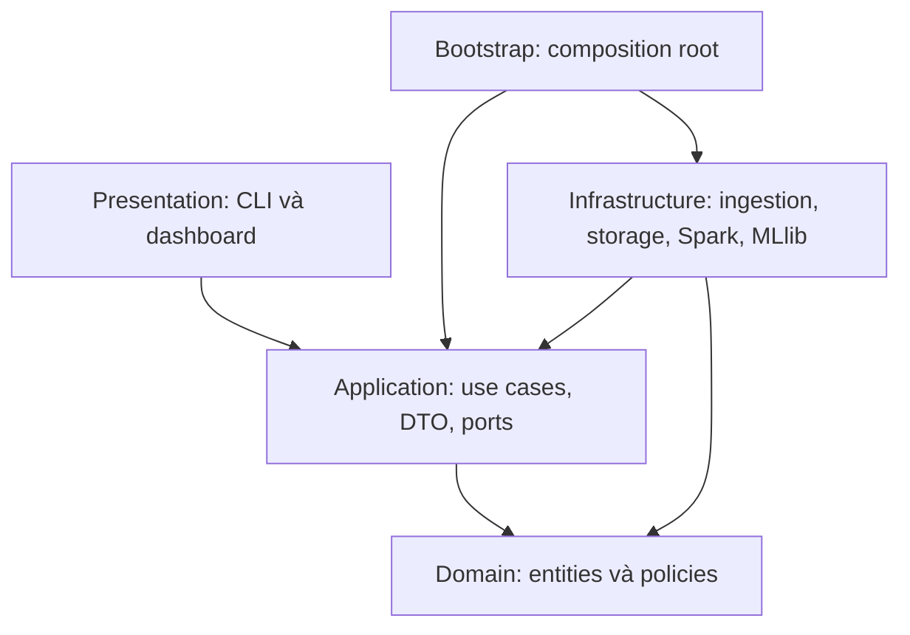

# Clean Architecture cho đồ án Steam Reviews

## 1. Phạm vi và chiều phụ thuộc

Giữ một codebase Python với bốn lớp; chưa cần microservice, event bus hoặc repository cho từng bảng. NiFi, HDFS và Spark là thành phần thực thi ngoài lõi nghiệp vụ.

Mũi tên biểu diễn phụ thuộc mã nguồn. Dữ liệu lúc chạy vẫn đi qua NiFi → HDFS → Spark → snapshot/dashboard. Entry point trong `presentation` được gọi `bootstrap` để tạo ứng dụng; đây là điểm ghép duy nhất, không phải lý do để mọi trang UI import adapter.

## 2. Trách nhiệm và giới hạn từng lớp

| Vị trí trong `src/steam_reviews/` | Đặt gì ở đây | Không đặt ở đây | Người chính |
|---|---|---|---|
| `domain/entities/` | Khái niệm đánh giá, dataset, run và định danh thuần Python khi cần | DataFrame, SparkSession, client HDFS | TV2 |
| `domain/policies/` | Chính sách nhãn hợp lệ, cách tính tỷ lệ, ngưỡng xếp hạng, quy tắc split/dedup | Đọc file, truy vấn SQL trực tiếp, gọi NiFi | TV2 |
| `application/ports/` | Protocol/ABC cho xử lý batch, lưu/đọc kết quả, huấn luyện | Implementation Spark/HTTP và tên endpoint cụ thể | TV2 + TV1 |
| `application/dto/` | Request/result nhỏ: dataset reference, run_id, filter, số đếm, metrics | Hàng triệu review hoặc kiểu của framework | TV2 |
| `application/use_cases/` | Điều phối kiểm tra đầu vào → gọi port → trả kết quả; thứ tự nghiệp vụ | Tạo SparkSession, Streamlit widgets, HTTP request | TV2 |
| `infrastructure/ingestion/` | Đọc metadata nguồn, checksum, manifest và tích hợp nguồn khi cần | Quy tắc hiển thị dashboard | TV1 |
| `infrastructure/storage/` | Thao tác HDFS, file/snapshot, xác minh và commit đầu ra | Chính sách nghiệp vụ nằm rải rác trong client | TV1 |
| `infrastructure/spark/` | DataFrame/SQL để chuẩn hóa, dedup, aggregate theo policy đã chốt | UI hoặc logic điều hướng trang | TV2 |
| `infrastructure/ml/` | Feature pipeline MLlib, fit/predict/evaluate, lưu/nạp model | Chọn kết quả thuận lợi bằng test set | TV2 |
| `presentation/cli/` | Parse tham số, gọi bootstrap/use case, in kết quả và exit code | ETL/huấn luyện viết trực tiếp trong entry point | TV2 + TV1 |
| `presentation/dashboard/` | Trang, biểu đồ, filter, chuyển DTO nhỏ sang dữ liệu hiển thị | Đọc raw HDFS hoặc khởi chạy training khi đổi bộ lọc | TV3 |
| `bootstrap/` | Đọc cấu hình môi trường, tạo adapter, inject vào use case | Quy tắc nhãn, tính KPI, giao diện | TV1 + TV2 |

Luật import: `domain` chỉ dùng thư viện chuẩn; `application` dùng thư viện chuẩn + domain; `infrastructure` được import application/domain và thư viện công nghệ; `presentation` dùng application cùng thư viện UI/CLI; `bootstrap` được biết các lớp để ghép chúng. Không import presentation từ infrastructure hoặc từ lớp bên trong.

## 3. Hợp đồng và use case sẽ triển khai

Các tên dưới đây là **hướng dẫn đặt mã**, chưa phải class/function đã tồn tại. Chốt chữ ký sau khi kiểm tra dataset D2.

| Use case dự kiến | Port cần dùng | Adapter thực thi | Kết quả nhỏ trả về |
|---|---|---|---|
| `PrepareDataset` | `DatasetSource`, `ManifestStore` | Nguồn cục bộ/Kaggle metadata | Tham chiếu mẫu, checksum, manifest |
| `CleanReviews` | `ReviewBatchProcessor` | Spark ETL | Silver reference và thống kê chất lượng |
| `BuildAnalytics` | `AnalyticsProcessor` | Spark SQL | Gold reference và số đếm đối soát |
| `TrainRecommendationModel` | `ModelTrainer` | Spark MLlib | Model reference, split manifest, validation metrics |
| `EvaluateRecommendationModel` | `ModelEvaluator` | Spark MLlib | Test metrics, tham chiếu dự đoán mẫu |
| `ExportDashboardSnapshot` | `SnapshotExporter` | Adapter gold → snapshot nhỏ | Snapshot reference và run_id |
| `GetDashboardAnalytics` | `AnalyticsReader` | Adapter đọc snapshot cục bộ | Bảng tổng hợp nhỏ và metadata |

Port khai báo theo thao tác nghiệp vụ ở mức batch. Ví dụ `CleanReviews` truyền dataset reference và chính sách làm sạch sang `ReviewBatchProcessor`; adapter chạy DataFrame và trả tham chiếu silver. Không vòng lặp qua toàn bộ review trong domain, không lấy mỗi hàng thành một entity Python để giả lập xử lý phân tán.

Các chính sách phải có một nguồn định nghĩa rõ. Khi chuyển chính sách sang biểu thức Spark, kiểm tra bằng fixture nhỏ để bảo đảm cùng ý nghĩa; không duy trì hai cách xử lý nhãn/dedup khác nhau. Spark DataFrame chỉ lưu chuyển nội bộ các adapter Spark/ML, không xuất hiện trong chữ ký port công khai.

## 4. Những thành phần ngoài package Python

- `nifi/flows/`: flow JSON nhập/xuất qua NiFi; `nifi/parameters/`: mẫu tham số an toàn. TV1 chịu trách nhiệm vận hành, retry, back pressure, commit batch.
- `infra/`: Compose/Dockerfile và cấu hình cụm; chỉ tạo file thực thi khi có cấu hình đã kiểm tra. Bộ khung chưa có file Compose giả.
- `schemas/`: hợp đồng vật lý source/silver/gold; quy tắc nghiệp vụ thuần nằm trong domain. Mọi lớp phối hợp theo schema version, run_id và manifest.
- `scripts/`: wrapper submit job/export/benchmark; gọi CLI hoặc công cụ hạ tầng, không sao chép nghiệp vụ vào script.
- `data/`: tệp cục bộ. Bronze/silver/gold chính trên HDFS theo `Plan.md`, không đồng nhất thư mục cục bộ với HDFS.
- `artifacts/`: đầu ra thực nghiệm và tham chiếu; `docs/evidence/`: ảnh/log đã chọn lọc chứng minh tiêu chí; không lưu log runtime vô hạn.

## 5. Phân chia kiểm thử khi bắt đầu triển khai

| Thư mục | Nội dung cần kiểm tra | Điều kiện |
|---|---|---|
| `tests/unit/` | Nhãn, KPI mẫu số 0, quy tắc nghiệp vụ; điều phối use case qua fake port | Không cần NiFi/HDFS/Spark |
| `tests/integration/` | Spark transform, schema, lưu/đọc, manifest, contract giữa adapter và port | Chạy đúng runtime phụ thuộc của adapter |
| `tests/e2e/` | Pipeline smoke, retry/replay, dashboard so với gold | Cụm và artifact mẫu sẵn sàng |
| `tests/fixtures/` | CSV đa dòng, dấu nháy, Unicode, nhãn sai, ID/text trùng và kết quả mong đợi | Dữ liệu nhỏ, có thể commit |

Hiện chỉ tạo nơi đặt kiểm thử, chưa có test hoặc kết quả kiểm thử chức năng. Khi review mã, đối chiếu quy tắc import, không đưa DataFrame vào port và không tải dữ liệu lớn lên driver.
