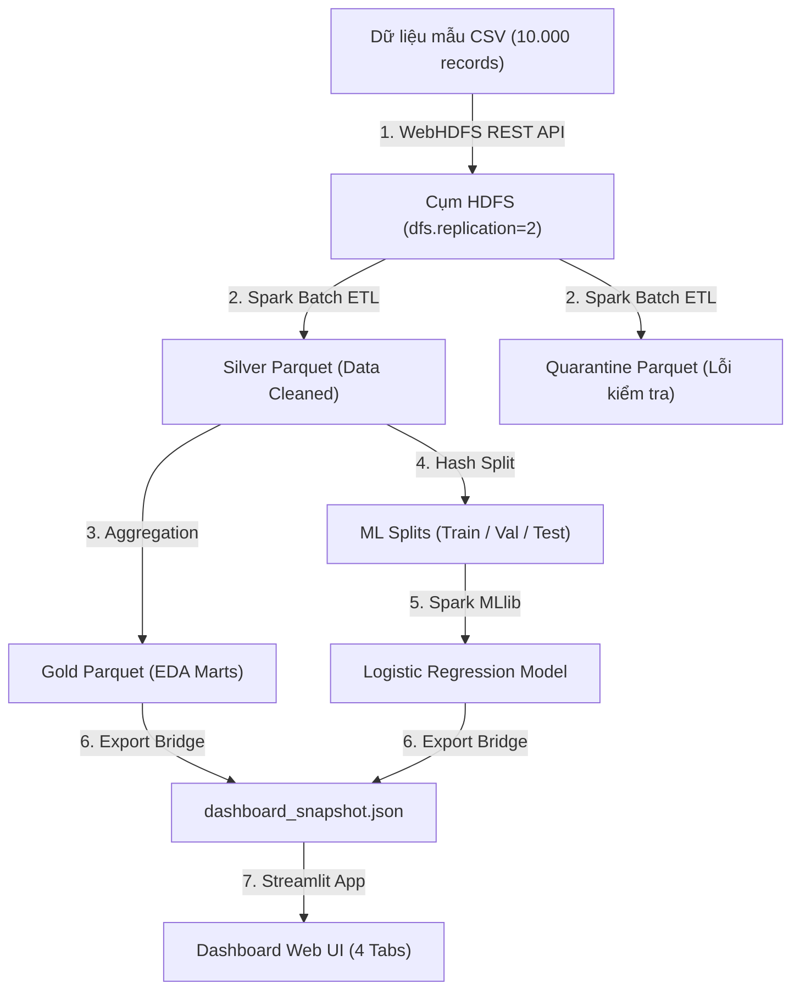

Ran command: Check data directory (`Get-ChildItem -Path data -Recurse -Depth 2`)
Viewed ingest_sample_to_hdfs.py:15-45
Viewed main.py:100-156
Viewed main.py:55-95
Viewed ingest_sample_to_hdfs.py:100-135
Ran command: List scripts directory (`Get-ChildItem -Path scripts`)
Viewed run_tv2.ps1:1-11
Ran command: List docs directory (`Get-ChildItem -Path docs -Recurse`)
Viewed cluster-deployment-runbook.md:1-95
Viewed tv2_local_pipeline.md:1-66

Dưới đây là cẩm nang hướng dẫn chi tiết từng bước (**Step-by-Step Runbook**) để bạn có thể tự mình vận hành toàn bộ luồng pipeline từ **Hạ tầng phân tán (TV1)**, **Xử lý dữ liệu & Huấn luyện ML (TV2)** đến **Báo cáo Trực quan hóa trên Dashboard (TV1)**.

---

### TỔNG QUAN LUỒNG THỰC THI (END-TO-END PIPELINE)



---

### GIAI ĐOẠN 0: CHUẨN BỊ MÔI TRƯỜNG

1. **Khởi động Docker Desktop:** Đảm bảo Docker Desktop trên Windows đang ở trạng thái `Running` (biểu tượng cá voi màu xanh).
2. **Mở PowerShell:** Mở terminal PowerShell tại thư mục gốc của dự án:
   ```powershell
   cd c:\code\Bigdata
   ```
3. **Kiểm tra Python và Thư viện:**
   ```powershell
   py -3.13 -m pytest tests/unit
   ```
   > Đảm bảo kết quả hiển thị **`58 passed`** để xác nhận môi trường code và các domain rule hoàn toàn lành lặn.

---

### BƯỚC 1: KHỞI ĐỘNG CỤM PHÂN TÁN DOCKER (TV1-W05)

Khởi động toàn bộ 7 container dịch vụ (HDFS NameNode + 2 DataNodes, Spark Master + 2 Workers, Apache NiFi):

```powershell
docker compose -f infra/docker/docker-compose.yml up -d
```

#### Kiểm tra sức khỏe cụm (Health Check):
1. **Trạng thái các container:**
   ```powershell
   docker compose -f infra/docker/docker-compose.yml ps
   ```
   *(Tất cả 7 container đều phải ở trạng thái `running`)*.

2. **Kiểm tra liên kết HDFS phân tán:**
   ```powershell
   docker exec hdfs-namenode hdfs dfsadmin -report
   ```
   *(Kỳ vọng thấy: `Live datanodes (2)` và tổng dung lượng lưu trữ phân tán hiển thị đủ cả 2 node)*.

3. **Kiểm tra các Web UI:**
   - **HDFS NameNode Web UI:** Mở trình duyệt vào [http://localhost:9870](http://localhost:9870) (kiểm tra mục Datanodes).
   - **Spark Master Web UI:** Mở trình duyệt vào [http://localhost:8080](http://localhost:8080) (kiểm tra `Alive Workers: 2`, tổng 4 Cores, 4GB RAM).
   - **Apache NiFi:** Mở [https://localhost:8443/nifi](https://localhost:8443/nifi) (Tài khoản: `admin` / `BigDataSteam2026!`).

---

### BƯỚC 2: INGEST DỮ LIỆU MẪU VÀO HDFS QUA WEBHDFS (TV1-W06)

Chạy script nạp tự động tệp dữ liệu mẫu [data/sample/steam_reviews_sample_10k.csv](file:///c:/code/Bigdata/data/sample/steam_reviews_sample_10k.csv) vào cụm HDFS:

```powershell
py -3.13 scripts/ingest_sample_to_hdfs.py
```

- **Cơ chế hoạt động:**
  - Đọc 10.000 dòng dữ liệu mẫu, chia thành 2 lô (5.000 dòng/lô).
  - Gửi request `CREATE` lên WebHDFS NameNode (`http://localhost:9870`).
  - Tự động bắt mã `HTTP 307 Temporary Redirect` và đẩy dữ liệu trực tiếp vào DataNode được chỉ định.
  - Tự động gọi `OPEN` để kiểm chứng ngược lại số lượng record đã lưu vào HDFS.
- **Kỳ vọng:** Xuất hiện thông báo:
  ```text
  [+] Nạp thành công vào HDFS: /steam/bronze/sample/batch_01.csv
  [+] Nạp thành công vào HDFS: /steam/bronze/sample/batch_02.csv
  [+] Kiểm chứng khớp: 10,000 logical records trong HDFS
  ```

---

### BƯỚC 3: THỰC THI SPARK ETL: BRONZE -> SILVER -> GOLD (TV2-W07)

Thực hiện quy trình làm sạch, khử trùng lặp, cách ly dữ liệu lỗi (Quarantine) và tổng hợp các bảng phân tích Gold:

```powershell
py -3.13 -m steam_reviews.presentation.cli.main etl --source data/sample/steam_reviews_sample_10k.csv --level core --run-id core-cluster-01
```

> [!TIP]
> Bạn cũng có thể dùng file wrapper rút gọn:
> ```powershell
> .\scripts\run_tv2.ps1 etl --source data\sample\steam_reviews_sample_10k.csv --level core --run-id core-cluster-01
> ```

- **Kết quả sinh ra:**
  - `data/lake/silver/core-cluster-01/`: Tệp Parquet đã được chuẩn hóa và làm sạch.
  - `data/lake/quarantine/core-cluster-01/`: Các bài đánh giá lỗi schema, rỗng nội dung hoặc sai lệch timestamp.
  - `data/lake/gold/core-cluster-01/`: Các bảng phân tích Parquet theo Game, Tháng, Ngôn ngữ, và Giờ chơi.
  - `artifacts/metrics/core-cluster-01/quality_counts.json`: Báo cáo số lượng bản ghi kiểm định chất lượng (V1 - V4).

---

### BƯỚC 4: THỰC THI MACHINE LEARNING PIPELINE (TV2-W08)

Chạy tuần tự 3 lệnh phân chia tập dữ liệu, huấn luyện mô hình và đánh giá trên tập kiểm thử độc lập:

#### 4.1. Phân chia tập dữ liệu (Hash-based Split & Leakage Check):
```powershell
py -3.13 -m steam_reviews.presentation.cli.main ml-prepare --run-id core-cluster-01 --max-rows 10000
```
- Phân chia tập dữ liệu thành `train` (80%), `validation` (10%), `test` (10%) bằng băm `review_id` để đảm bảo tính tất định và chống rò rỉ dữ liệu (No Data Leakage).

#### 4.2. Huấn luyện mô hình (Model Training & Selection):
```powershell
py -3.13 -m steam_reviews.presentation.cli.main ml-train --run-id core-cluster-01
```
- Huấn luyện mô hình cơ sở (Majority Baseline) và 4 cấu hình Logistic Regression với siêu tham số regularization khác nhau (`reg_param` = 0.01, 0.05, 0.1, 0.2).
- Tự động chọn mô hình có điểm `Macro-F1` cao nhất trên tập `validation`.

#### 4.3. Đánh giá kiểm thử (Test Evaluation & Error Mining):
```powershell
py -3.13 -m steam_reviews.presentation.cli.main ml-evaluate --run-id core-cluster-01 --errors 30
```
- Đánh giá mô hình đã chọn trên tập `test`.
- Trích xuất 30 mẫu dự đoán sai (False Positive / False Negative) để phân tích nguyên nhân nhầm lẫn.

---

### BƯỚC 5: XUẤT BẢN SNAPSHOT CHO DASHBOARD (BRIDGE TV1 & TV2)

Kết xuất toàn bộ dữ liệu từ các bảng Gold Parquet và các file chỉ số ML vừa huấn luyện thành file Snapshot JSON chuẩn hóa:

```powershell
py -3.13 scripts/export_dashboard_snapshot.py --run-id core-cluster-01
```

- **Đầu ra:** Tạo tệp `artifacts/snapshots/dashboard_snapshot_core-cluster-01.json` tuân thủ 100% hợp đồng dữ liệu [schemas/gold/dashboard_contract_v1.json](file:///c:/code/Bigdata/schemas/gold/dashboard_contract_v1.json).

---

### BƯỚC 6: KHỞI CHẠY STREAMLIT DASHBOARD (TV1-W09)

Kích hoạt Dashboard tương tác của TV1 đọc trực tiếp file snapshot vừa tạo:

```powershell
$env:STEAM_DASHBOARD_SNAPSHOT_PATH="artifacts/snapshots/dashboard_snapshot_core-cluster-01.json"
py -3.13 -m streamlit run src/steam_reviews/presentation/dashboard/app.py
```

- **Trải nghiệm trên giao diện:** Trình duyệt sẽ tự động mở trang [http://localhost:8501](http://localhost:8501) với 4 phân hệ chính:
  1. **Tab 1: Overview:** Tổng quan số lượng review, tỷ lệ recommend, bộ lọc theo Game và Ngôn ngữ.
  2. **Tab 2: Data Quality:** Biểu đồ đối soát dữ liệu đầu vào, tỷ lệ giữ lại (Retention), phân loại các nguyên nhân bị cách ly (Quarantine reasons).
  3. **Tab 3: Deep Dive (EDA):** Xu hướng đánh giá theo thời gian, phân tích tương quan giữa số giờ đã chơi (`author_playtime_forever`) và mức độ hài lòng.
  4. **Tab 4: Model Ops:** Ma trận nhầm lẫn (Confusion Matrix), so sánh Macro-F1 giữa Baseline và Logistic Regression, phân tích chi tiết các ca phân loại sai.

---

### BƯỚC 7: TẮT CỤM KHI HOÀN TẤT PHIÊN LÀM VIỆC

Khi đã demo hoặc kiểm tra xong, bạn có thể giải phóng tài nguyên CPU/RAM máy tính:

- **Nếu muốn tắt nhưng giữ lại dữ liệu trong HDFS:**
  ```powershell
  docker compose -f infra/docker/docker-compose.yml stop
  ```
- **Nếu muốn dọn dẹp toàn bộ container:**
  ```powershell
  docker compose -f infra/docker/docker-compose.yml down
  ```

---

### XỬ LÝ SỰ CỐ THƯỜNG GẶP (TROUBLESHOOTING)

| Tình huống | Nguyên nhân | Cách khắc phục |
|---|---|---|
| Lỗi WebHDFS `Failed to connect` | Container `hdfs-namenode` chưa khởi động xong | Chờ 15-20 giây sau khi chạy `docker compose up`, kiểm tra lại tại `http://localhost:9870`. |
| Cảnh báo `HADOOP_HOME` trên Windows | Windows chưa cài `winutils.exe` | Hệ thống đã có cơ chế fallback tự động xử lý. Pipeline vẫn chạy bình thường với `UserWarning`. |
| Trình duyệt báo `Privacy Error` khi vào NiFi | NiFi 2.0 mặc định dùng HTTPS với chứng chỉ tự ký (Self-signed) | Bấm **Advanced (Nâng cao)** -> **Proceed to localhost (Tiếp tục truy cập)**. |
| Test unit báo fail `is_fixture` | Biến môi trường `STEAM_DASHBOARD_SNAPSHOT_PATH` đang trỏ vào snapshot thật | Chạy `$env:STEAM_DASHBOARD_SNAPSHOT_PATH=""` trước khi chạy pytest unit. |